Join me for a roadtrip in the heart of Turkish Anatolia, where I explore Kapadokya and the underground city of Derinkuyu.

This trip was in January 2023, before the disastrous earthquake which shook this region. To support the communities affected by this disaster, consider donating to a relief fund [such as this one](https://www.islamicreliefcanada.org/emergencies/turkey-syria-earthquake).

# Day 1 - Kapadokya

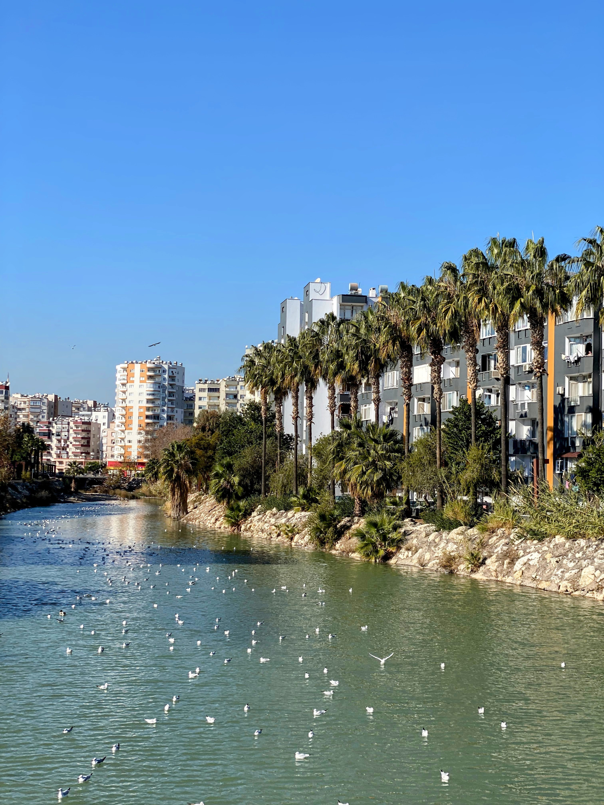{: width="3024" height="4032" decoding="auto" fetchpriority="high" srcset="/assets/img/article_imgs/turkey-roadtrip/reading/0-mersin-480.webp 480w, /assets/img/article_imgs/turkey-roadtrip/reading/0-mersin-800.webp 800w, /assets/img/article_imgs/turkey-roadtrip/reading/0-mersin-1300.webp 1300w" sizes="(max-width: 698px) calc(100vw - 48px), 650px"}

we start the journey in the mediterranean city of Mersin and hit the road going North to the heart of Anatolia.

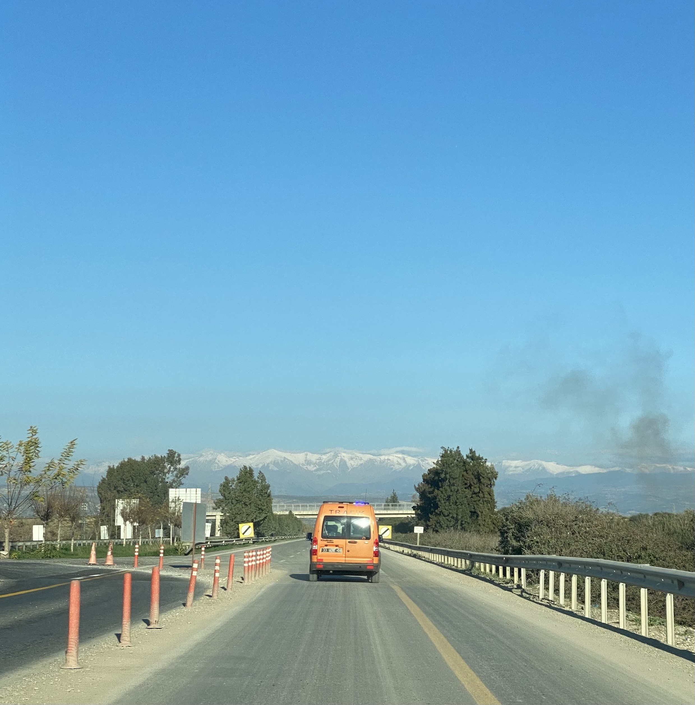{: width="2479" height="2513" decoding="async" loading="lazy" srcset="/assets/img/article_imgs/turkey-roadtrip/reading/1-road-480.webp 480w, /assets/img/article_imgs/turkey-roadtrip/reading/1-road-800.webp 800w, /assets/img/article_imgs/turkey-roadtrip/reading/1-road-1300.webp 1300w" sizes="(max-width: 698px) calc(100vw - 48px), 650px"}

The plan is to explore the Kapadokya region, stop by Kayseri, then come back to Adana and eventually Mersin.

I'm most looking forward to exploring the ruins in Göreme, Nevşehir, Derinkuyu Underground City and everything in between.

Our planned journey looks something like this:

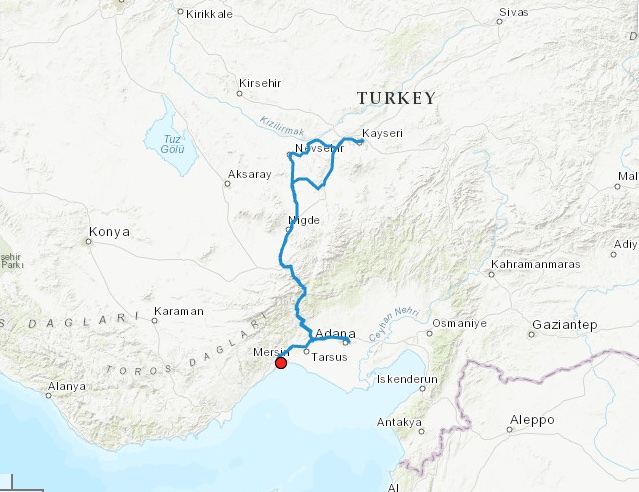{: width="639" height="492" decoding="async" loading="lazy" srcset="/assets/img/article_imgs/turkey-roadtrip/reading/2-map-480.webp 480w, /assets/img/article_imgs/turkey-roadtrip/reading/2-map-639.webp 639w" sizes="(max-width: 698px) calc(100vw - 48px), 650px"}

As we leave Mersin behind and cross into the Taurus Mountains, the landscape dramatically transforms from the vibrant blues of the Mediterranean to the earthy tones of Anatolia.

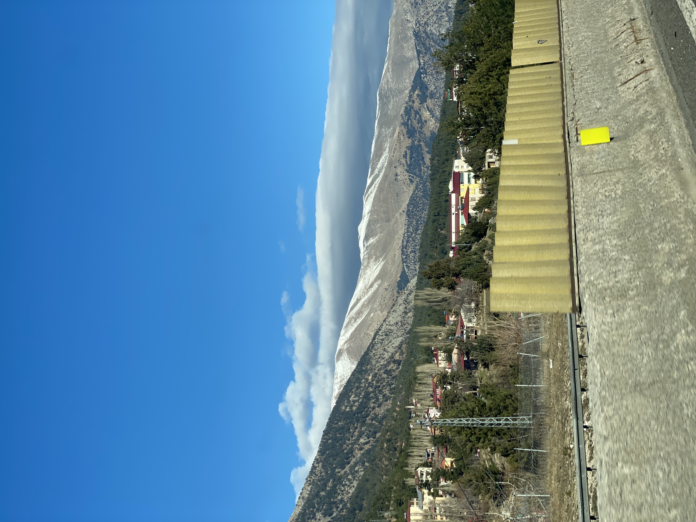{: width="3024" height="4032" decoding="async" loading="lazy" srcset="/assets/img/article_imgs/turkey-roadtrip/reading/3-terrain-480.webp 480w, /assets/img/article_imgs/turkey-roadtrip/reading/3-terrain-800.webp 800w, /assets/img/article_imgs/turkey-roadtrip/reading/3-terrain-1300.webp 1300w" sizes="(max-width: 698px) calc(100vw - 48px), 650px"}
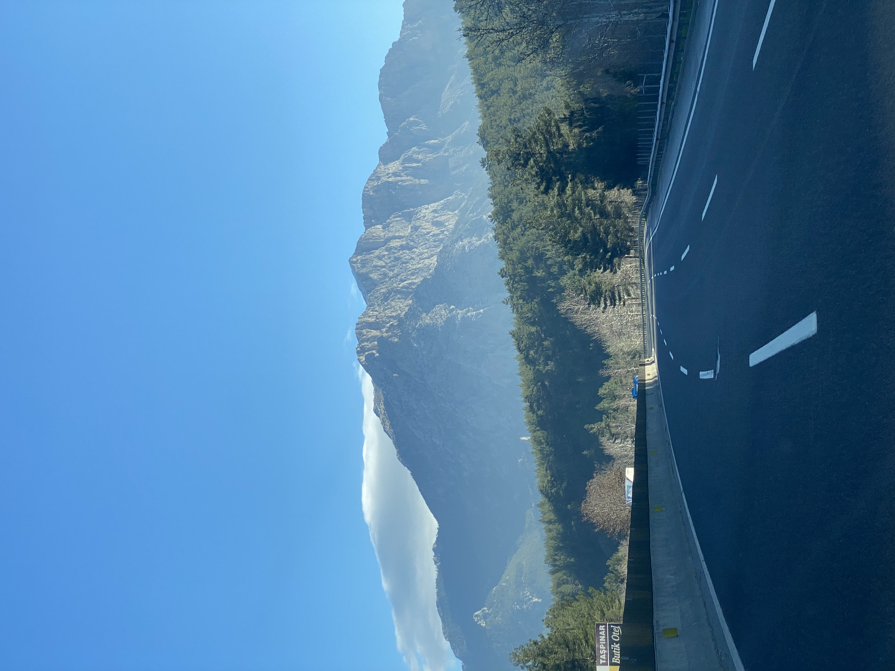{: width="3024" height="4032" decoding="async" loading="lazy" srcset="/assets/img/article_imgs/turkey-roadtrip/reading/4-terrain-480.webp 480w, /assets/img/article_imgs/turkey-roadtrip/reading/4-terrain-800.webp 800w, /assets/img/article_imgs/turkey-roadtrip/reading/4-terrain-1300.webp 1300w" sizes="(max-width: 698px) calc(100vw - 48px), 650px"}

Our journey takes us through many small villages. We decide to stop by one, the town of Yeşilgölcük, as we noticed a town market was happening today.

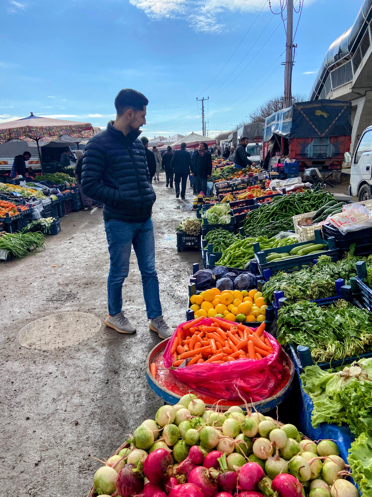{: width="3024" height="4032" decoding="async" loading="lazy" srcset="/assets/img/article_imgs/turkey-roadtrip/reading/5-town-market-480.webp 480w, /assets/img/article_imgs/turkey-roadtrip/reading/5-town-market-800.webp 800w, /assets/img/article_imgs/turkey-roadtrip/reading/5-town-market-1300.webp 1300w" sizes="(max-width: 698px) calc(100vw - 48px), 650px"}

After exploring this little market, we got pretty hungry so we found a local meat shop and had a delicious lunch.

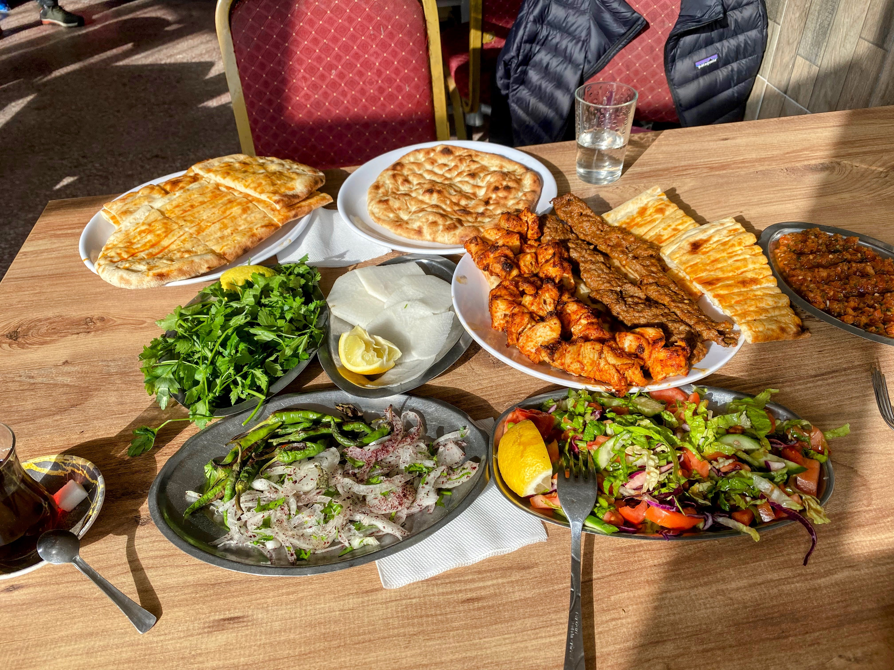{: width="4032" height="3024" decoding="async" loading="lazy" srcset="/assets/img/article_imgs/turkey-roadtrip/reading/6-lunch-480.webp 480w, /assets/img/article_imgs/turkey-roadtrip/reading/6-lunch-800.webp 800w, /assets/img/article_imgs/turkey-roadtrip/reading/6-lunch-1300.webp 1300w" sizes="(max-width: 698px) calc(100vw - 48px), 650px"}

Ottoman Sultans were known to [safeguard culinary methods and recipes](https://medium.com/exploring-history/food-that-conquered-the-world-the-ottoman-empire-3d58013e4ff2), and I can see why... Turkish food is outstanding and might be my favourite part of this country.

This lunch ran about 200 TRY (~$10 CAD). The exchange rate was definitely in our favour on this trip.

As we approach the our destination, we begin to notice hundreds of little caves along the road. These caves are believed to date back to the 7-8th centuries.

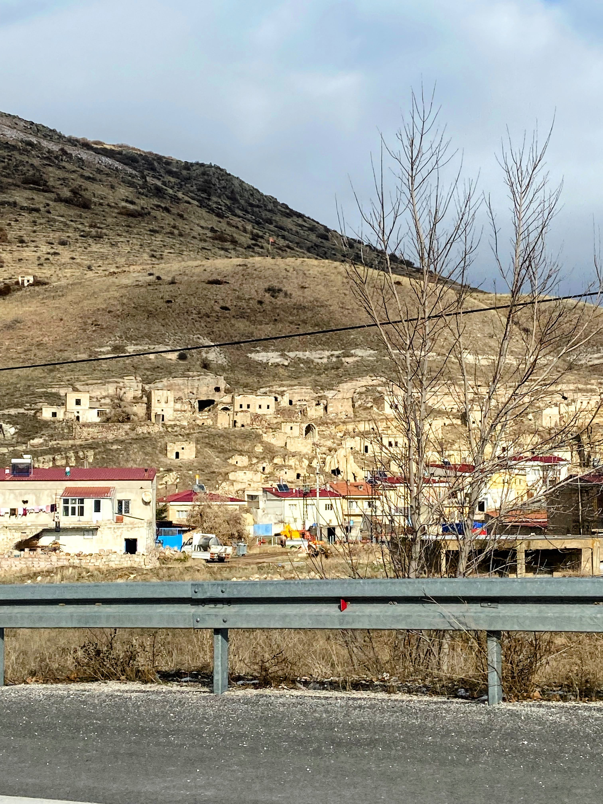{: width="3024" height="4032" decoding="async" loading="lazy" srcset="/assets/img/article_imgs/turkey-roadtrip/reading/7-mountain-caves-480.webp 480w, /assets/img/article_imgs/turkey-roadtrip/reading/7-mountain-caves-800.webp 800w, /assets/img/article_imgs/turkey-roadtrip/reading/7-mountain-caves-1300.webp 1300w" sizes="(max-width: 698px) calc(100vw - 48px), 650px"}

We finally arrive in the town of Uçhisar. 

While many people assume Kapadokya is a city, it's actually more of a region comprised of valleys and small towns you can drive through.

Uçhisar Castle.

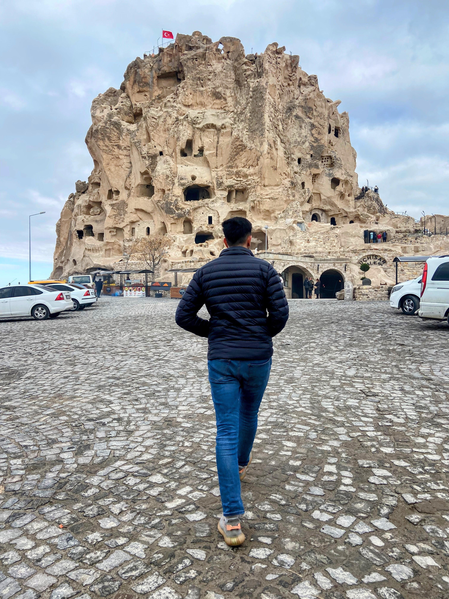{: width="3024" height="4032" decoding="async" loading="lazy" srcset="/assets/img/article_imgs/turkey-roadtrip/reading/8-kapadokya-480.webp 480w, /assets/img/article_imgs/turkey-roadtrip/reading/8-kapadokya-800.webp 800w, /assets/img/article_imgs/turkey-roadtrip/reading/8-kapadokya-1300.webp 1300w" sizes="(max-width: 698px) calc(100vw - 48px), 650px"}

A distinctive feature of the region are these "fairy chimney" rock clusters, shaped by centuries of volcanic activity and erosion in the region. It's quite an otherworldly landscape.

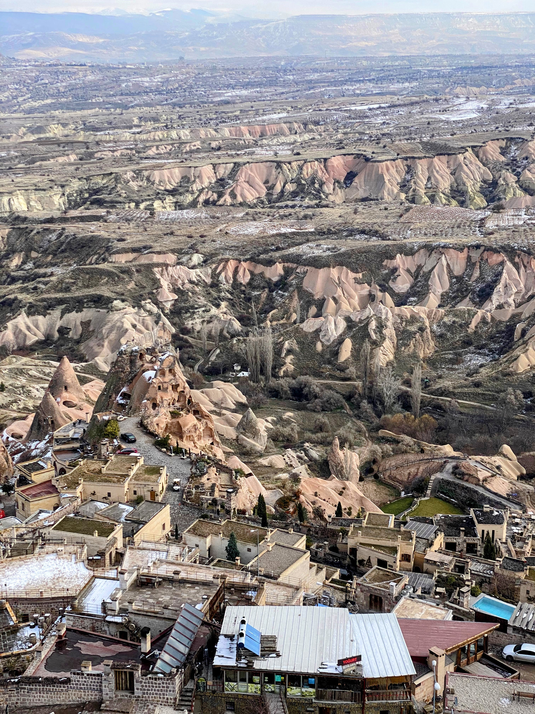{: width="3024" height="4032" decoding="async" loading="lazy" srcset="/assets/img/article_imgs/turkey-roadtrip/reading/9-caves-from-castle-480.webp 480w, /assets/img/article_imgs/turkey-roadtrip/reading/9-caves-from-castle-800.webp 800w, /assets/img/article_imgs/turkey-roadtrip/reading/9-caves-from-castle-1300.webp 1300w" sizes="(max-width: 698px) calc(100vw - 48px), 650px"}

Many people like to take the hot air balloons up and see the valley from the skies. Today, it was too windy to do so.

It's also the down seasons so not many tourists to be seen.

{: width="3024" height="4032" decoding="async" loading="lazy" srcset="/assets/img/article_imgs/turkey-roadtrip/reading/10-balloon-480.webp 480w, /assets/img/article_imgs/turkey-roadtrip/reading/10-balloon-800.webp 800w, /assets/img/article_imgs/turkey-roadtrip/reading/10-balloon-1300.webp 1300w" sizes="(max-width: 698px) calc(100vw - 48px), 650px"}

We instead opt to go hike down to the valley of [Göreme National Park](https://en.wikipedia.org/wiki/G%C3%B6reme_National_Park) and explore its many scattered caves. 

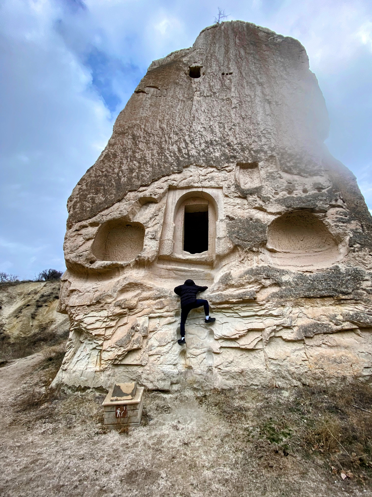{: width="3024" height="4032" decoding="async" loading="lazy" srcset="/assets/img/article_imgs/turkey-roadtrip/reading/11-climbing-cave-480.webp 480w, /assets/img/article_imgs/turkey-roadtrip/reading/11-climbing-cave-800.webp 800w, /assets/img/article_imgs/turkey-roadtrip/reading/11-climbing-cave-1300.webp 1300w" sizes="(max-width: 698px) calc(100vw - 48px), 650px"}

This one was an old (defaced) Christian church. Notice the face of Jesus scratched off and the faded red cross.

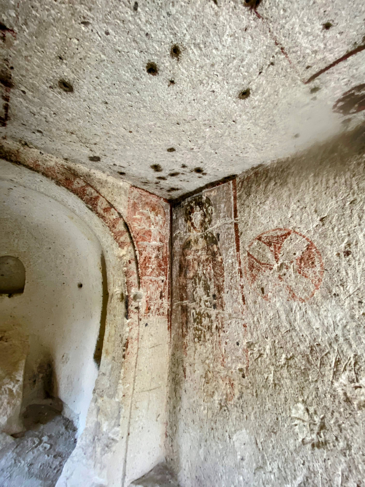{: width="3024" height="4032" decoding="async" loading="lazy" srcset="/assets/img/article_imgs/turkey-roadtrip/reading/33-defaced-church-480.webp 480w, /assets/img/article_imgs/turkey-roadtrip/reading/33-defaced-church-800.webp 800w, /assets/img/article_imgs/turkey-roadtrip/reading/33-defaced-church-1300.webp 1300w" sizes="(max-width: 698px) calc(100vw - 48px), 650px"}

Here's a cave church in much better condition, at the time of our visit it was being renovated.

These caves were used to hide from invaders by the ancient christian communities in the area.

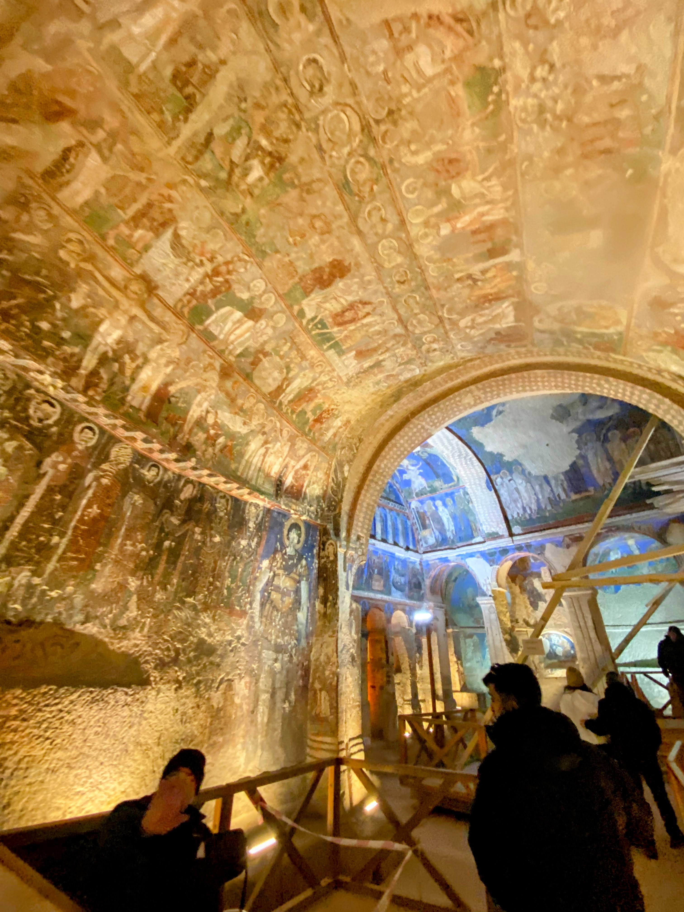{: width="3024" height="4032" decoding="async" loading="lazy" srcset="/assets/img/article_imgs/turkey-roadtrip/reading/12-church-cave-2-480.webp 480w, /assets/img/article_imgs/turkey-roadtrip/reading/12-church-cave-2-800.webp 800w, /assets/img/article_imgs/turkey-roadtrip/reading/12-church-cave-2-1300.webp 1300w" sizes="(max-width: 698px) calc(100vw - 48px), 650px"}

We continue exploring the valley.

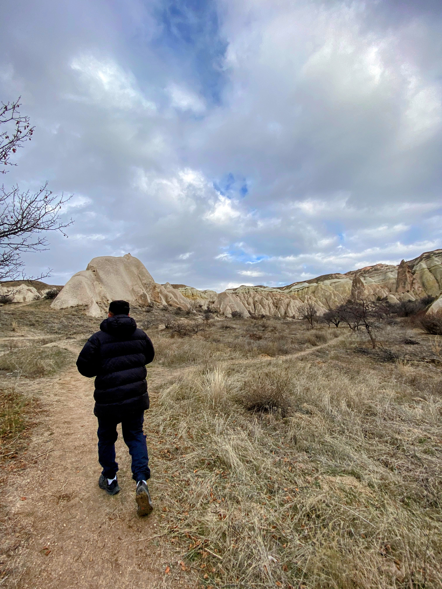{: width="3024" height="4032" decoding="async" loading="lazy" srcset="/assets/img/article_imgs/turkey-roadtrip/reading/13-landscape-valley-480.webp 480w, /assets/img/article_imgs/turkey-roadtrip/reading/13-landscape-valley-800.webp 800w, /assets/img/article_imgs/turkey-roadtrip/reading/13-landscape-valley-1300.webp 1300w" sizes="(max-width: 698px) calc(100vw - 48px), 650px"}

From the ancient Hittite civilization to the early Christians seeking refuge in its caves, Kapadokya has been a crossroads of cultures and a canvas for human resilience. The layers of history are woven into every stone, making it a place where the past feels alive.

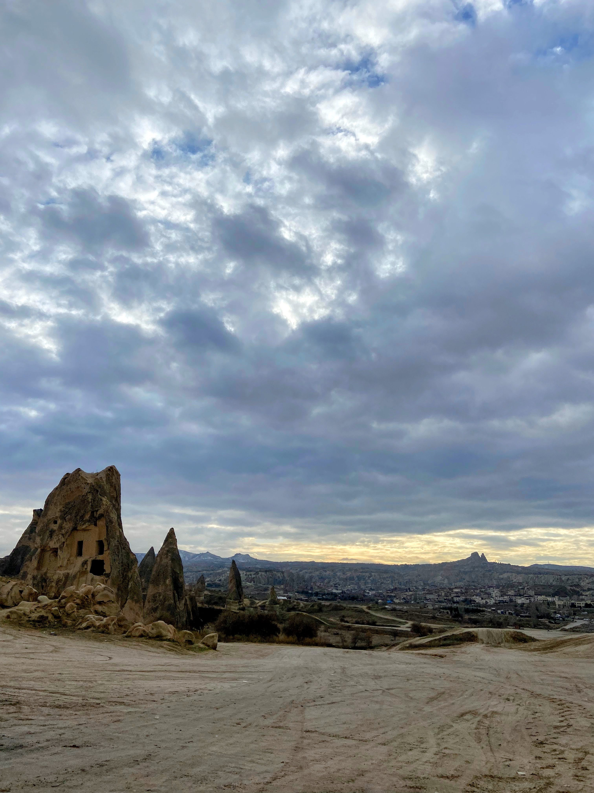{: width="3024" height="4032" decoding="async" loading="lazy" srcset="/assets/img/article_imgs/turkey-roadtrip/reading/14-landscape-480.webp 480w, /assets/img/article_imgs/turkey-roadtrip/reading/14-landscape-800.webp 800w, /assets/img/article_imgs/turkey-roadtrip/reading/14-landscape-1300.webp 1300w" sizes="(max-width: 698px) calc(100vw - 48px), 650px"}

After some technical mishaps, we finally meet up with some friends and had dinner in Göreme.

Turns out there's a lot more of them than can fit in our little Fiat, 

we make it work.

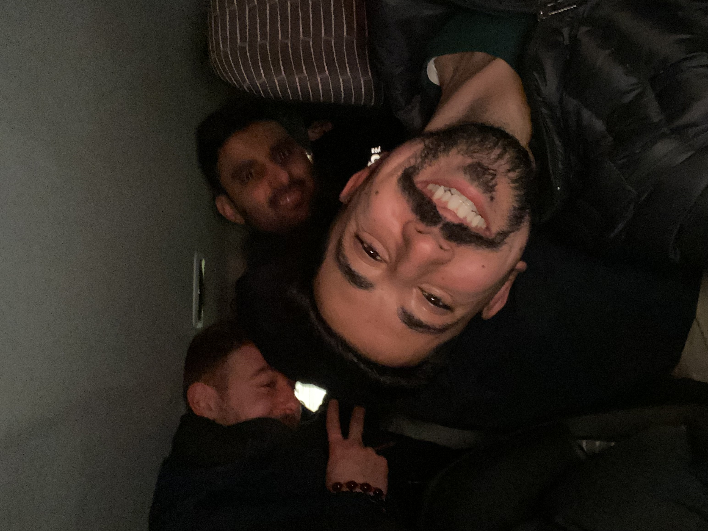{: width="2316" height="3088" decoding="async" loading="lazy" srcset="/assets/img/article_imgs/turkey-roadtrip/reading/15-boys-480.webp 480w, /assets/img/article_imgs/turkey-roadtrip/reading/15-boys-800.webp 800w, /assets/img/article_imgs/turkey-roadtrip/reading/15-boys-1300.webp 1300w" sizes="(max-width: 698px) calc(100vw - 48px), 650px"}

We drive up to Kayseri and drop off our friends at the Kayseri airport. 

Afterwards, we decide to spend the night in Kayseri and check in at the Radisson Blu Hotel. 

We mostly chose this hotel because it features a Turkish hammam, a public bath. 

Much needed after a long day of exploring.

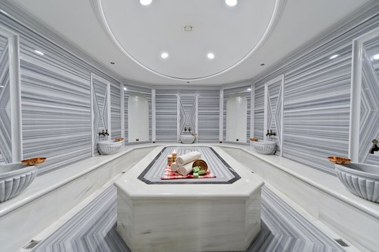{: width="550" height="367" decoding="async" loading="lazy" srcset="/assets/img/article_imgs/turkey-roadtrip/reading/16-spa-480.webp 480w, /assets/img/article_imgs/turkey-roadtrip/reading/16-spa-550.webp 550w" sizes="(max-width: 698px) calc(100vw - 48px), 650px"}

# Day 2 - Kayseri, Derinkuyu & Adana

We wake up to a beautiful winter morning in the city of Kayseri. It looks like a typical large Turkish city with tons of similar large apartment buildings in grids.

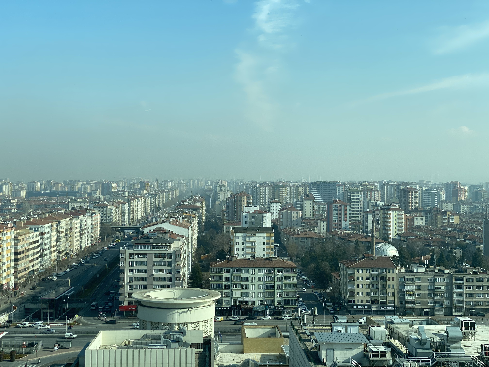{: width="4032" height="3024" decoding="async" loading="lazy" srcset="/assets/img/article_imgs/turkey-roadtrip/reading/17-morning-kayseri-480.webp 480w, /assets/img/article_imgs/turkey-roadtrip/reading/17-morning-kayseri-800.webp 800w, /assets/img/article_imgs/turkey-roadtrip/reading/17-morning-kayseri-1300.webp 1300w" sizes="(max-width: 698px) calc(100vw - 48px), 650px"}

As we hit the town square, retired men are drinking Cay (Tea) and playing backgammon.

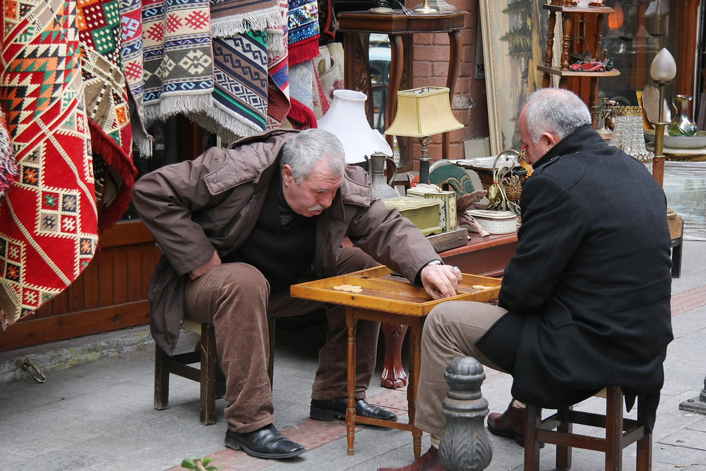{: width="1023" height="683" decoding="async" loading="lazy" srcset="/assets/img/article_imgs/turkey-roadtrip/reading/18-backgammon-tea-480.webp 479w, /assets/img/article_imgs/turkey-roadtrip/reading/18-backgammon-tea-800.webp 800w, /assets/img/article_imgs/turkey-roadtrip/reading/18-backgammon-tea-1023.webp 1023w" sizes="(max-width: 698px) calc(100vw - 48px), 650px"}
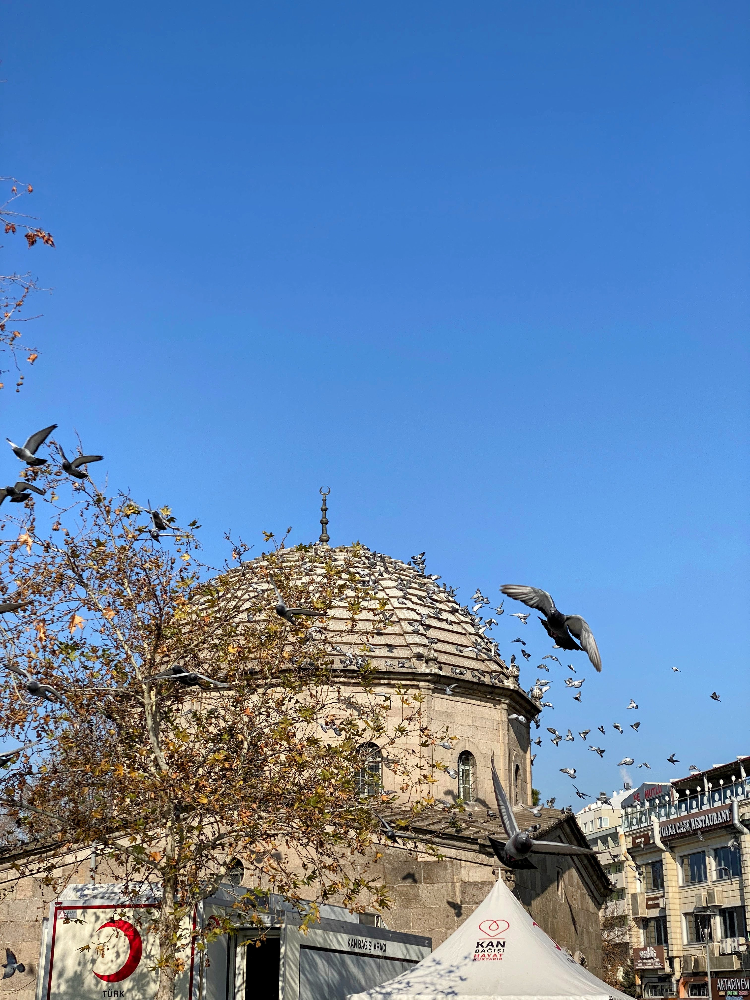{: width="3024" height="4032" decoding="async" loading="lazy" srcset="/assets/img/article_imgs/turkey-roadtrip/reading/27-pigeons-480.webp 480w, /assets/img/article_imgs/turkey-roadtrip/reading/27-pigeons-800.webp 800w, /assets/img/article_imgs/turkey-roadtrip/reading/27-pigeons-1300.webp 1300w" sizes="(max-width: 698px) calc(100vw - 48px), 650px"}

We go for a simple turkish breakfast. Some Sucuklu Tost (Grilled cheese and turkish sausage) and Cay.

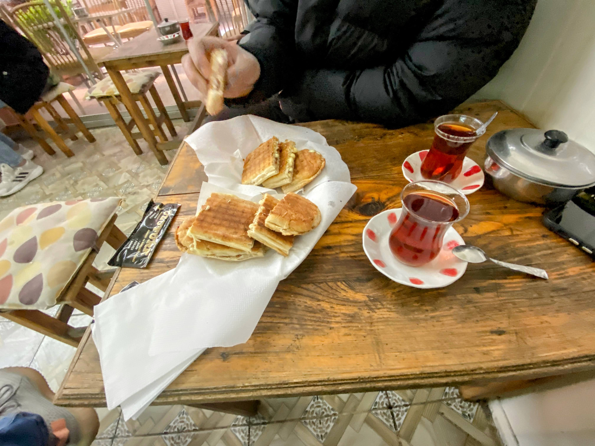{: width="4032" height="3024" decoding="async" loading="lazy" srcset="/assets/img/article_imgs/turkey-roadtrip/reading/19-breakfast-480.webp 480w, /assets/img/article_imgs/turkey-roadtrip/reading/19-breakfast-800.webp 800w, /assets/img/article_imgs/turkey-roadtrip/reading/19-breakfast-1300.webp 1300w" sizes="(max-width: 698px) calc(100vw - 48px), 650px"}

Turkish people drink lots of tea. 

In Kayseri, a special variety we noticed many drinking is Oralet. A fruit flavoured tea. 

This one is Watermelon and Strawberry.

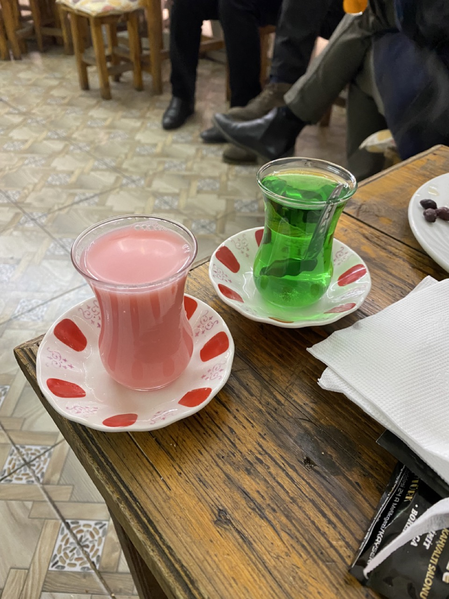{: width="960" height="1280" decoding="async" loading="lazy" srcset="/assets/img/article_imgs/turkey-roadtrip/reading/20-oralet-480.webp 480w, /assets/img/article_imgs/turkey-roadtrip/reading/20-oralet-800.webp 800w, /assets/img/article_imgs/turkey-roadtrip/reading/20-oralet-960.webp 960w" sizes="(max-width: 698px) calc(100vw - 48px), 650px"}

Looking to see what Kayseri has to offer in our limited time here, we go explore the Kayseri castle, dating back to 238 AD.

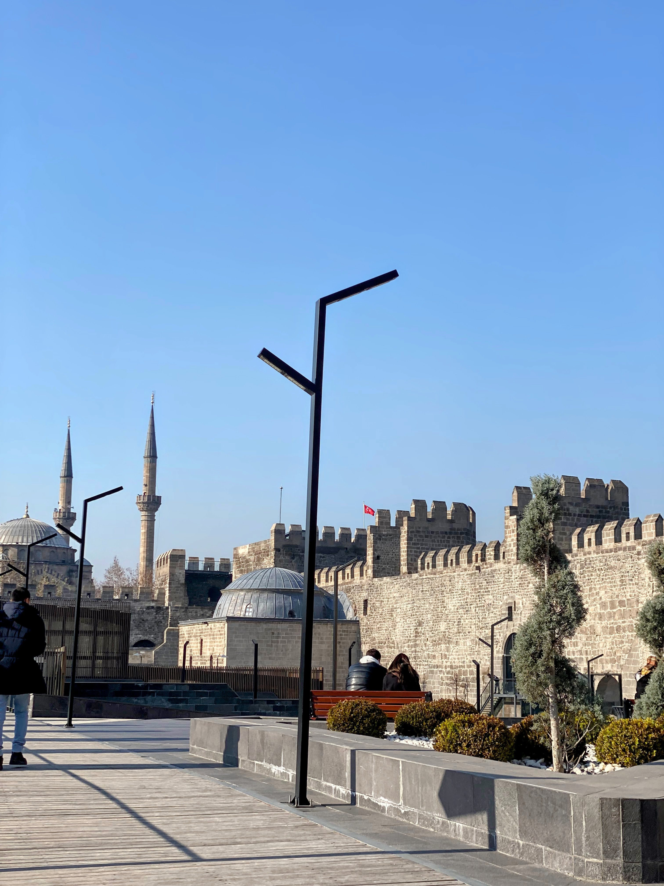{: width="3024" height="4032" decoding="async" loading="lazy" srcset="/assets/img/article_imgs/turkey-roadtrip/reading/21-kayseri-castle-480.webp 480w, /assets/img/article_imgs/turkey-roadtrip/reading/21-kayseri-castle-800.webp 800w, /assets/img/article_imgs/turkey-roadtrip/reading/21-kayseri-castle-1300.webp 1300w" sizes="(max-width: 698px) calc(100vw - 48px), 650px"}

An Ottoman map of Kayseri on display in Kayseri Castle, showcasing the castle (bottom) and surrounding landscape

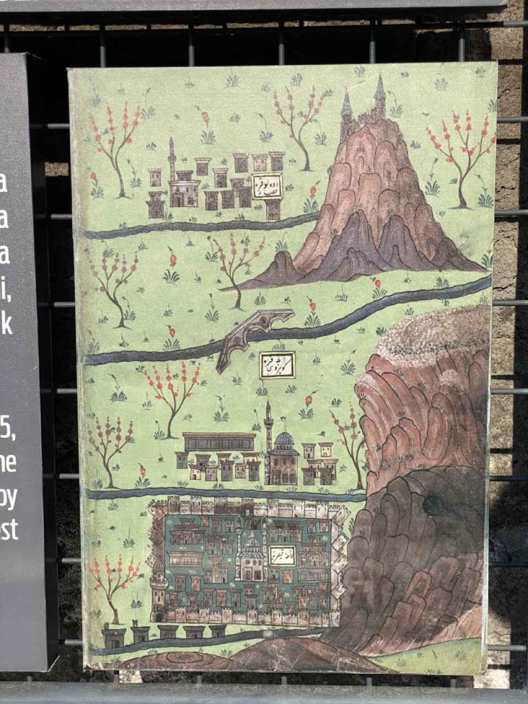{: width="960" height="1280" decoding="async" loading="lazy" srcset="/assets/img/article_imgs/turkey-roadtrip/reading/22-kayseri-map-480.webp 480w, /assets/img/article_imgs/turkey-roadtrip/reading/22-kayseri-map-800.webp 800w, /assets/img/article_imgs/turkey-roadtrip/reading/22-kayseri-map-960.webp 960w" sizes="(max-width: 698px) calc(100vw - 48px), 650px"}

Kayseri Castle has had many ups and downs throughout its history. It underwent several phases of abandonment, transformations into slum settlements, and even internal demolitions to clear the slum encampments. 

However, in 2016, with the availability of funding, a restoration project was initiated. This initiative led to the restoration of the castle's structural integrity and transformed it into a touristic attraction featuring a museum and artisanal shops.

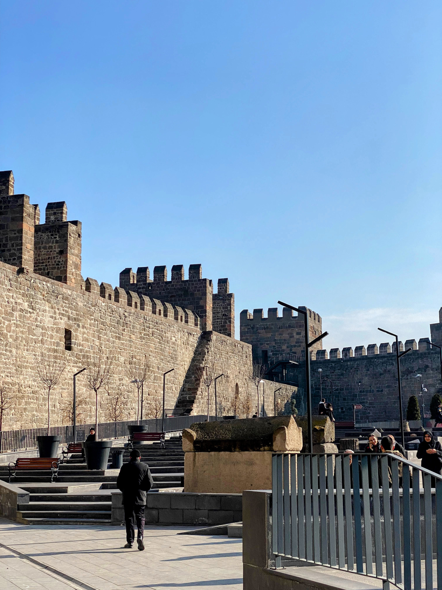{: width="3024" height="4032" decoding="async" loading="lazy" srcset="/assets/img/article_imgs/turkey-roadtrip/reading/23-kayseri-inside-480.webp 480w, /assets/img/article_imgs/turkey-roadtrip/reading/23-kayseri-inside-800.webp 800w, /assets/img/article_imgs/turkey-roadtrip/reading/23-kayseri-inside-1300.webp 1300w" sizes="(max-width: 698px) calc(100vw - 48px), 650px"}

An Ottoman Ney maker inside the castle. Thr Ney is a type of flute.

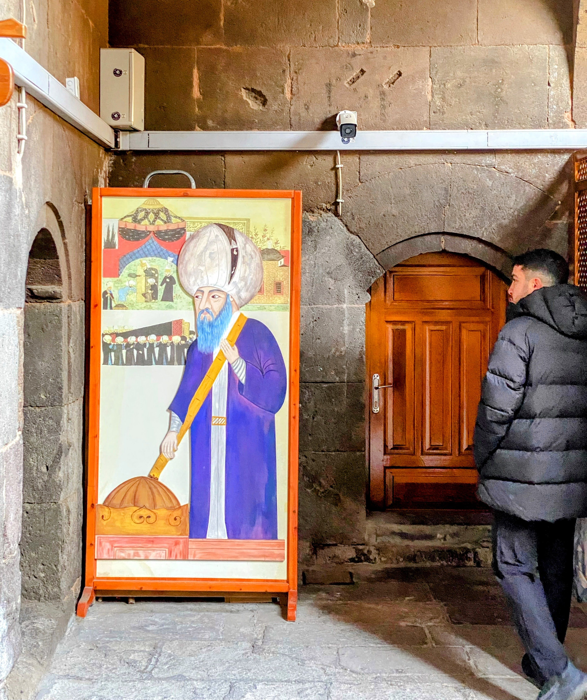{: width="2842" height="3386" decoding="async" loading="lazy" srcset="/assets/img/article_imgs/turkey-roadtrip/reading/24-ney-480.webp 480w, /assets/img/article_imgs/turkey-roadtrip/reading/24-ney-800.webp 800w, /assets/img/article_imgs/turkey-roadtrip/reading/24-ney-1300.webp 1300w" sizes="(max-width: 698px) calc(100vw - 48px), 650px"}

Before leaving Kayseri, we stop by a cured meat shop to pickup the local specialty, Pastırma.

A spiced cured meat.

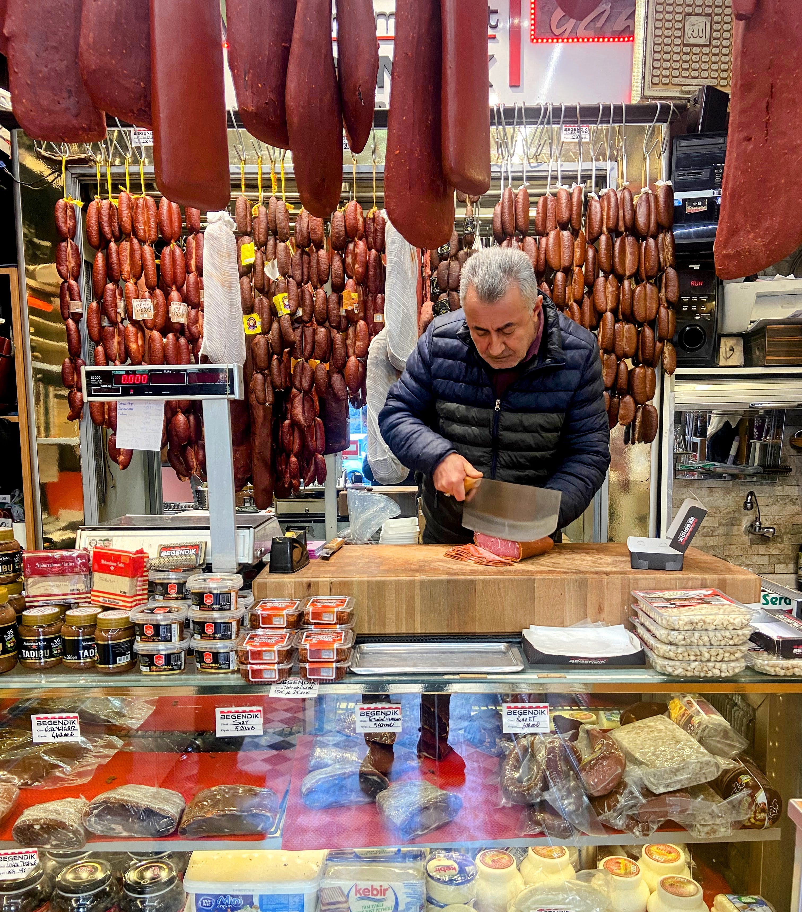{: width="3024" height="3440" decoding="async" loading="lazy" srcset="/assets/img/article_imgs/turkey-roadtrip/reading/25-basturma-480.webp 480w, /assets/img/article_imgs/turkey-roadtrip/reading/25-basturma-800.webp 800w, /assets/img/article_imgs/turkey-roadtrip/reading/25-basturma-1300.webp 1300w" sizes="(max-width: 698px) calc(100vw - 48px), 650px"}

On the itinerary for today is the underground city of Derinkuyu. 

We hit the road yet again, taking a scenic mountainous route. 

We catch a breathtaking glimpse of [Mount Erciyes](https://en.wikipedia.org/wiki/Mount_Erciyes), elevation 3,917m.

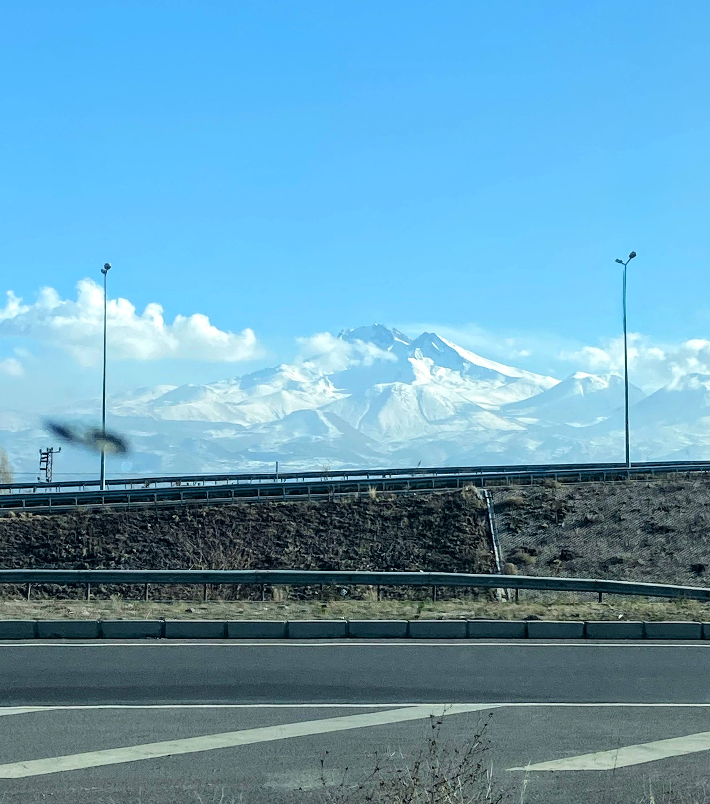{: width="3024" height="3422" decoding="async" loading="lazy" srcset="/assets/img/article_imgs/turkey-roadtrip/reading/26-mount-erciyes-480.webp 480w, /assets/img/article_imgs/turkey-roadtrip/reading/26-mount-erciyes-800.webp 800w, /assets/img/article_imgs/turkey-roadtrip/reading/26-mount-erciyes-1300.webp 1300w" sizes="(max-width: 698px) calc(100vw - 48px), 650px"}

The weather was perfect with clear skies, high visibility, and beautiful views.

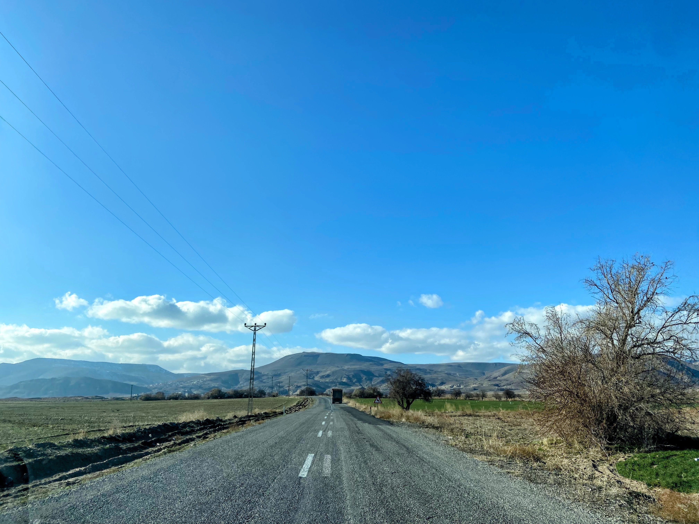{: width="4032" height="3024" decoding="async" loading="lazy" srcset="/assets/img/article_imgs/turkey-roadtrip/reading/29-road-480.webp 480w, /assets/img/article_imgs/turkey-roadtrip/reading/29-road-800.webp 800w, /assets/img/article_imgs/turkey-roadtrip/reading/29-road-1300.webp 1300w" sizes="(max-width: 698px) calc(100vw - 48px), 650px"}

View of the valley from up top.

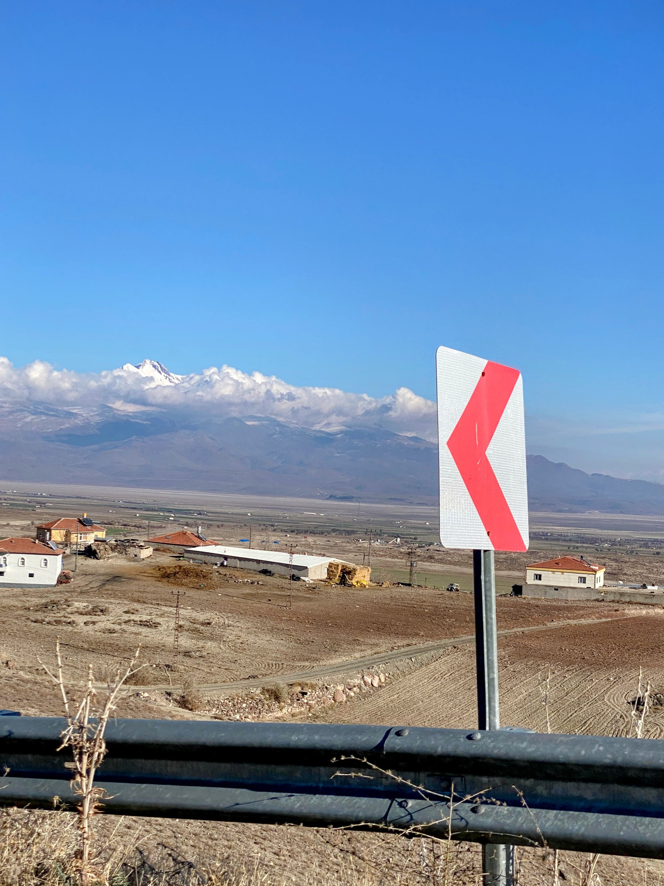{: width="2874" height="3833" decoding="async" loading="lazy" srcset="/assets/img/article_imgs/turkey-roadtrip/reading/28-valley-480.webp 480w, /assets/img/article_imgs/turkey-roadtrip/reading/28-valley-800.webp 800w, /assets/img/article_imgs/turkey-roadtrip/reading/28-valley-1300.webp 1300w" sizes="(max-width: 698px) calc(100vw - 48px), 650px"}

As we get closer to Derinkuyu we start to notice thousands of caves nestled alongside the hills.

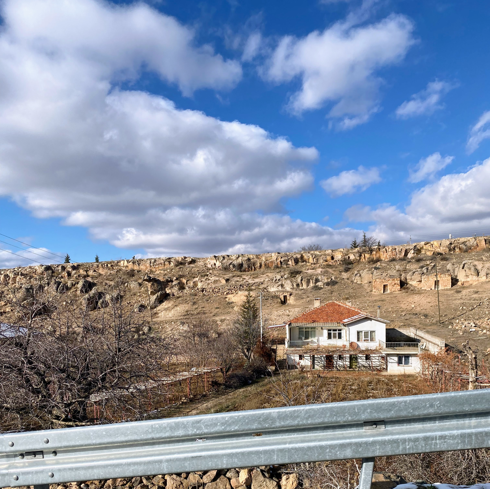{: width="3024" height="3020" decoding="async" loading="lazy" srcset="/assets/img/article_imgs/turkey-roadtrip/reading/30-caves-480.webp 480w, /assets/img/article_imgs/turkey-roadtrip/reading/30-caves-800.webp 800w, /assets/img/article_imgs/turkey-roadtrip/reading/30-caves-1300.webp 1300w" sizes="(max-width: 698px) calc(100vw - 48px), 650px"}

This region felt a bit eery as we hardly saw anyone in sight.

These homes built into the hill we suspect were abandoned not too long ago.

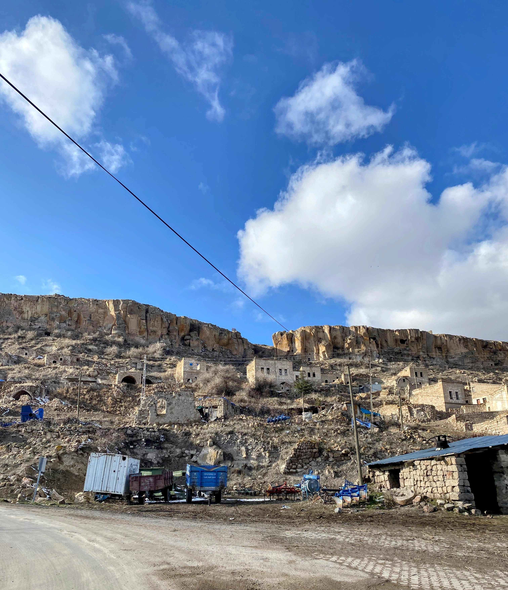{: width="3024" height="3512" decoding="async" loading="lazy" srcset="/assets/img/article_imgs/turkey-roadtrip/reading/31-caves-480.webp 480w, /assets/img/article_imgs/turkey-roadtrip/reading/31-caves-800.webp 800w, /assets/img/article_imgs/turkey-roadtrip/reading/31-caves-1300.webp 1300w" sizes="(max-width: 698px) calc(100vw - 48px), 650px"}

Arrived.

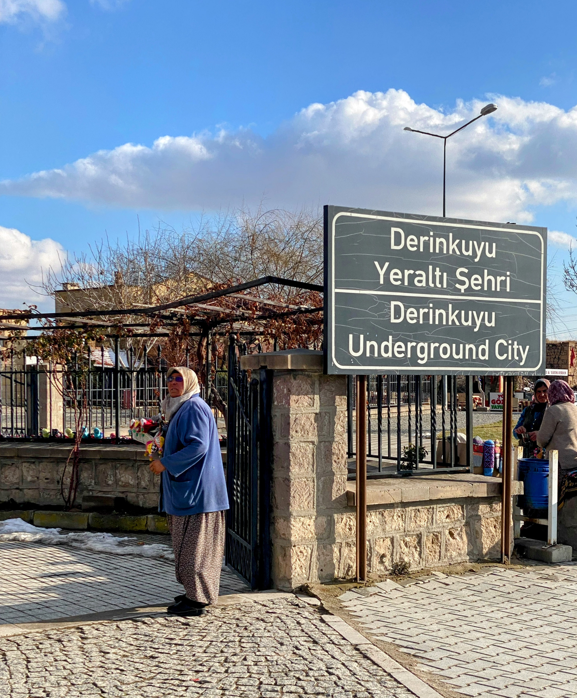{: width="2956" height="3571" decoding="async" loading="lazy" srcset="/assets/img/article_imgs/turkey-roadtrip/reading/32-derinkuyu-480.webp 480w, /assets/img/article_imgs/turkey-roadtrip/reading/32-derinkuyu-800.webp 800w, /assets/img/article_imgs/turkey-roadtrip/reading/32-derinkuyu-1300.webp 1300w" sizes="(max-width: 698px) calc(100vw - 48px), 650px"}

Carved beneath the Kapadokya landscapes we've seen so far is a series of underground cities. 

Derinkuyu Underground City is the largest one discovered yet.

A marvel of ancient engineering and dating back to the 7-8th centuries AD, this subterranean city was created to shelter thousands from invasions and persecution. 

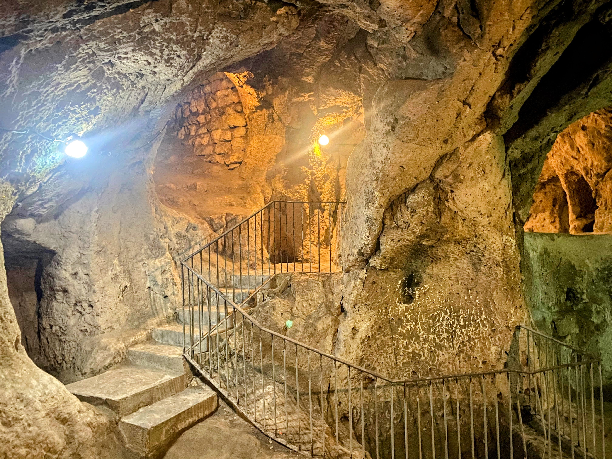{: width="4032" height="3024" decoding="async" loading="lazy" srcset="/assets/img/article_imgs/turkey-roadtrip/reading/34-derinkuyu-480.webp 480w, /assets/img/article_imgs/turkey-roadtrip/reading/34-derinkuyu-800.webp 800w, /assets/img/article_imgs/turkey-roadtrip/reading/34-derinkuyu-1300.webp 1300w" sizes="(max-width: 698px) calc(100vw - 48px), 650px"}

It extends over eight levels and ~85 metres deep. 

This shaft is part of the system which ensures air circulation throughout the city.

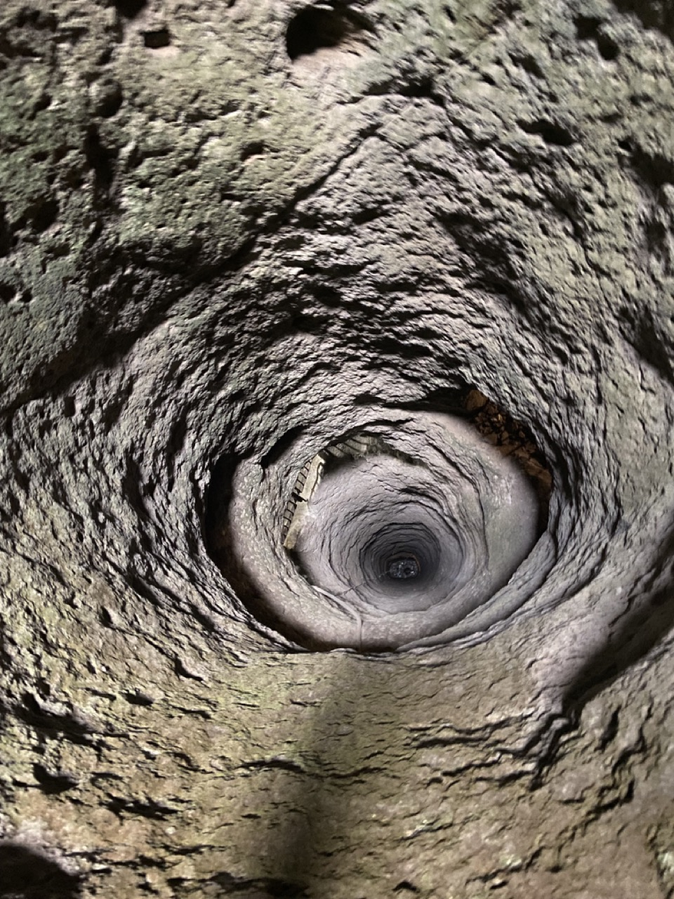{: width="960" height="1280" decoding="async" loading="lazy" srcset="/assets/img/article_imgs/turkey-roadtrip/reading/35-air-hole-480.webp 480w, /assets/img/article_imgs/turkey-roadtrip/reading/35-air-hole-800.webp 800w, /assets/img/article_imgs/turkey-roadtrip/reading/35-air-hole-960.webp 960w" sizes="(max-width: 698px) calc(100vw - 48px), 650px"}

Historians believe the city was inhabited by up to 20,000 residents, which means it had full infrastructure to support living such as churches, stables, kitchens, and even this school.

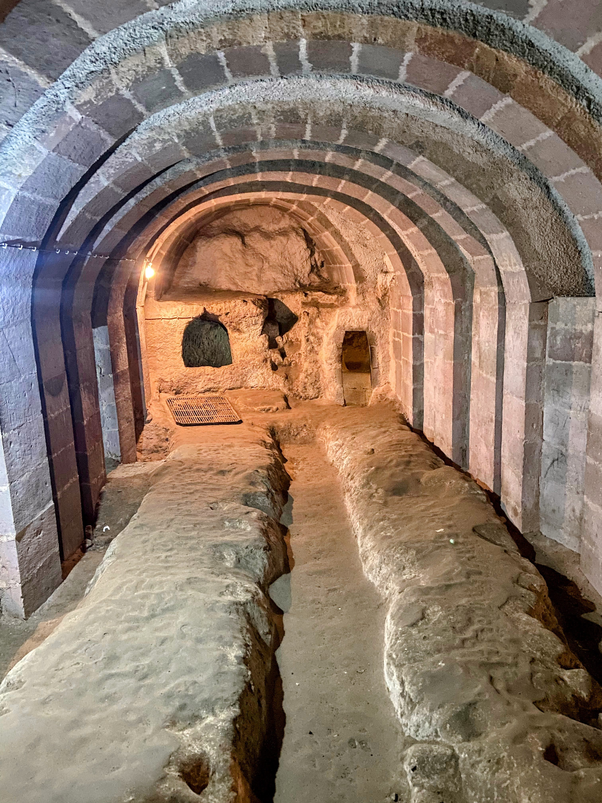{: width="3024" height="4032" decoding="async" loading="lazy" srcset="/assets/img/article_imgs/turkey-roadtrip/reading/36-school-480.webp 480w, /assets/img/article_imgs/turkey-roadtrip/reading/36-school-800.webp 800w, /assets/img/article_imgs/turkey-roadtrip/reading/36-school-1300.webp 1300w" sizes="(max-width: 698px) calc(100vw - 48px), 650px"}

Seriously interesting.

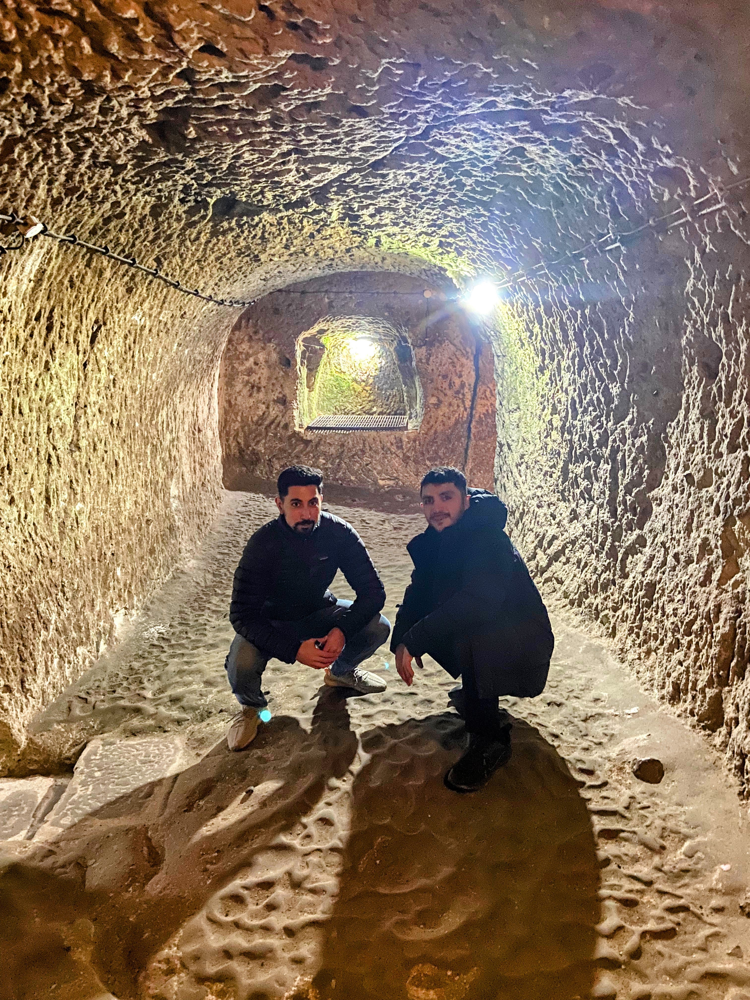{: width="3024" height="4032" decoding="async" loading="lazy" srcset="/assets/img/article_imgs/turkey-roadtrip/reading/37-underground-480.webp 480w, /assets/img/article_imgs/turkey-roadtrip/reading/37-underground-800.webp 800w, /assets/img/article_imgs/turkey-roadtrip/reading/37-underground-1300.webp 1300w" sizes="(max-width: 698px) calc(100vw - 48px), 650px"}

We make it up back to civilization and head to our next destination, hoping to make it there at a reasonable hour.

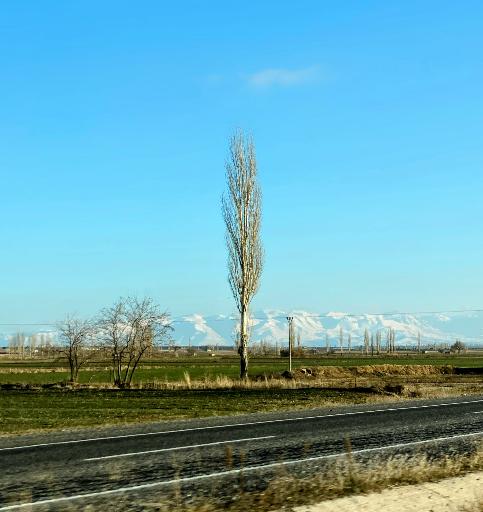{: width="2289" height="2424" decoding="async" loading="lazy" srcset="/assets/img/article_imgs/turkey-roadtrip/reading/38-road-480.webp 480w, /assets/img/article_imgs/turkey-roadtrip/reading/38-road-800.webp 800w, /assets/img/article_imgs/turkey-roadtrip/reading/38-road-1300.webp 1300w" sizes="(max-width: 698px) calc(100vw - 48px), 650px"}

Along the highway we encounter a major road accident. A semi flipped over and its cargo was dumped all over the road. The entire highway was backed up.

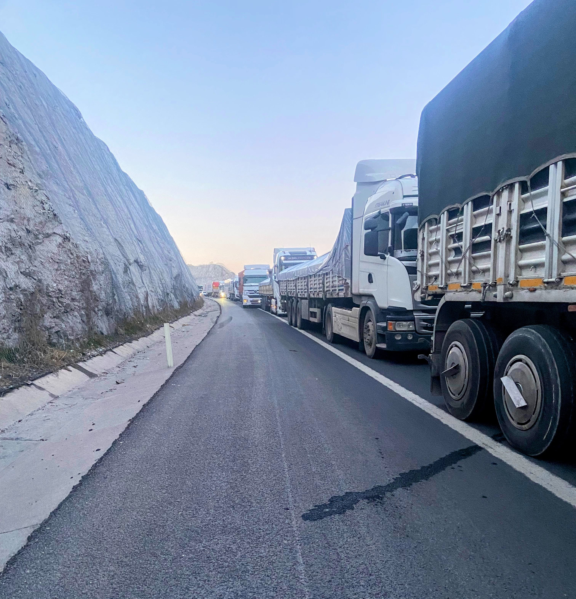{: width="3024" height="3143" decoding="async" loading="lazy" srcset="/assets/img/article_imgs/turkey-roadtrip/reading/39-highway-480.webp 480w, /assets/img/article_imgs/turkey-roadtrip/reading/39-highway-800.webp 800w, /assets/img/article_imgs/turkey-roadtrip/reading/39-highway-1300.webp 1300w" sizes="(max-width: 698px) calc(100vw - 48px), 650px"}

We assumed we'd be stuck waiting for hours considering we're in the middle of nowhere. 

To our surprise, road crews came in, cleaned up the roads, towed away the semi, and opened the highway again within only 20-30mins of waiting.

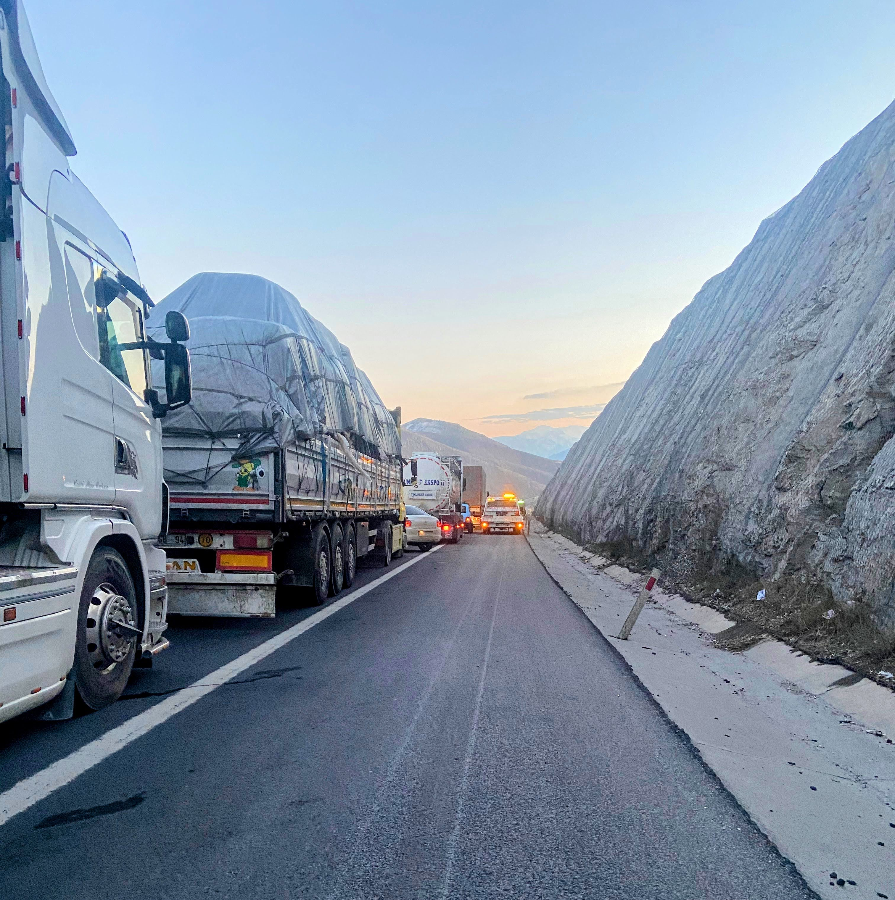{: width="3024" height="3042" decoding="async" loading="lazy" srcset="/assets/img/article_imgs/turkey-roadtrip/reading/40-highway-480.webp 480w, /assets/img/article_imgs/turkey-roadtrip/reading/40-highway-800.webp 800w, /assets/img/article_imgs/turkey-roadtrip/reading/40-highway-1300.webp 1300w" sizes="(max-width: 698px) calc(100vw - 48px), 650px"}

It's clear this country puts a lot of emphasis on clean, operational highway roads.

We're welcomed to Adana by the Sabancı Central Mosque at 7:30pm.

It's one of the largest mosques in Turkey with 6 towering minarets.

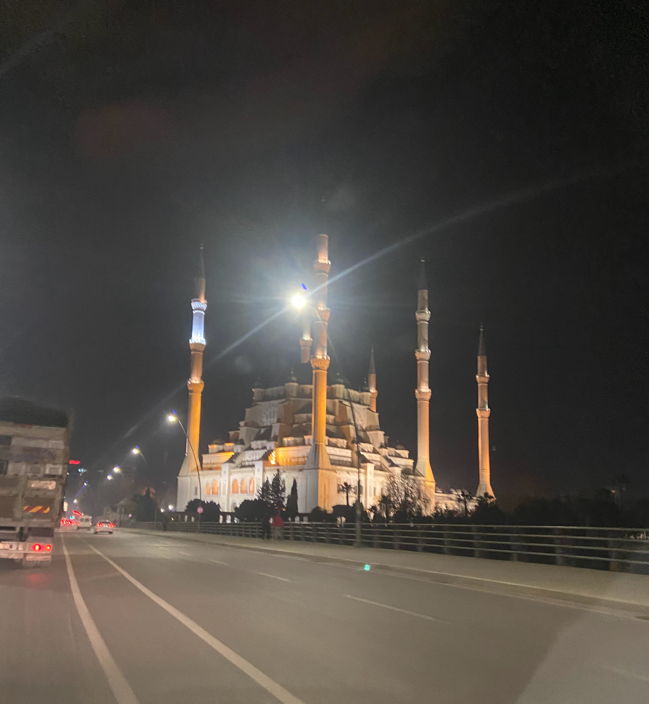{: width="3024" height="3277" decoding="async" loading="lazy" srcset="/assets/img/article_imgs/turkey-roadtrip/reading/41-mosque-480.webp 480w, /assets/img/article_imgs/turkey-roadtrip/reading/41-mosque-800.webp 800w, /assets/img/article_imgs/turkey-roadtrip/reading/41-mosque-1300.webp 1300w" sizes="(max-width: 698px) calc(100vw - 48px), 650px"}

Our arrival in Adana marks the beginning to the end of our trip. We rest up after an eventful day.

# Day 3

Friday morning in Adana means it's time to go for Friday prayers. We know exactly which mosque to go to.

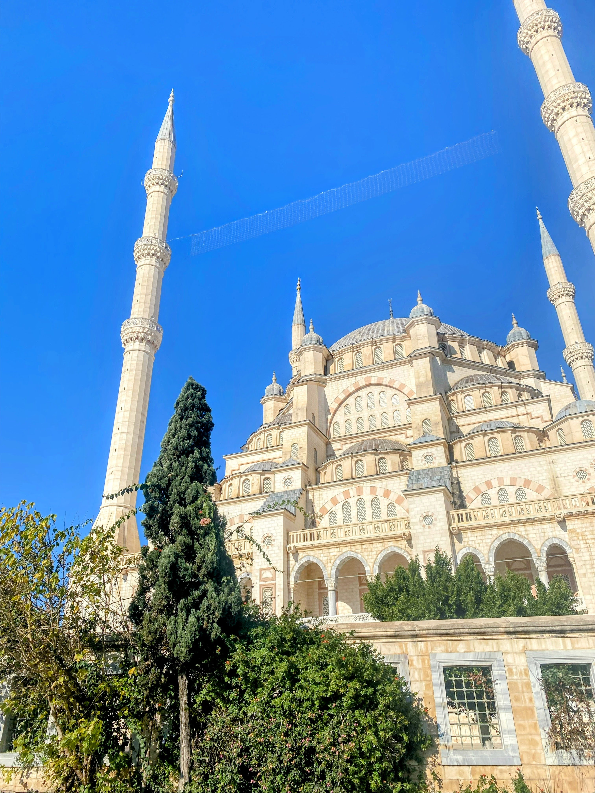{: width="3024" height="4032" decoding="async" loading="lazy" srcset="/assets/img/article_imgs/turkey-roadtrip/reading/42-mosque-480.webp 480w, /assets/img/article_imgs/turkey-roadtrip/reading/42-mosque-800.webp 800w, /assets/img/article_imgs/turkey-roadtrip/reading/42-mosque-1300.webp 1300w" sizes="(max-width: 698px) calc(100vw - 48px), 650px"}

The grand size of the mosque makes it humbling to be inside.

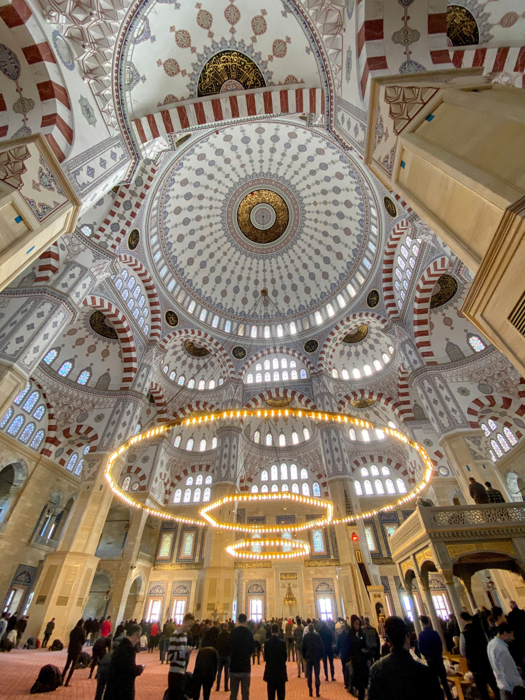{: width="3024" height="4032" decoding="async" loading="lazy" srcset="/assets/img/article_imgs/turkey-roadtrip/reading/43-mosque-480.webp 480w, /assets/img/article_imgs/turkey-roadtrip/reading/43-mosque-800.webp 800w, /assets/img/article_imgs/turkey-roadtrip/reading/43-mosque-1300.webp 1300w" sizes="(max-width: 698px) calc(100vw - 48px), 650px"}

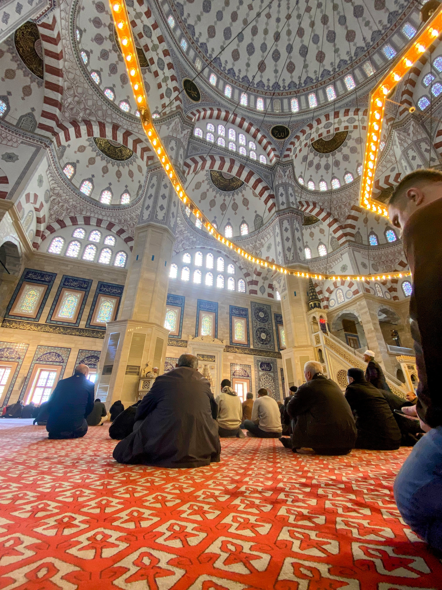{: width="3024" height="4032" decoding="async" loading="lazy" srcset="/assets/img/article_imgs/turkey-roadtrip/reading/44-mosque-480.webp 480w, /assets/img/article_imgs/turkey-roadtrip/reading/44-mosque-800.webp 800w, /assets/img/article_imgs/turkey-roadtrip/reading/44-mosque-1300.webp 1300w" sizes="(max-width: 698px) calc(100vw - 48px), 650px"}

After prayer, we go for a traditional turkish breakfast. Delicious.

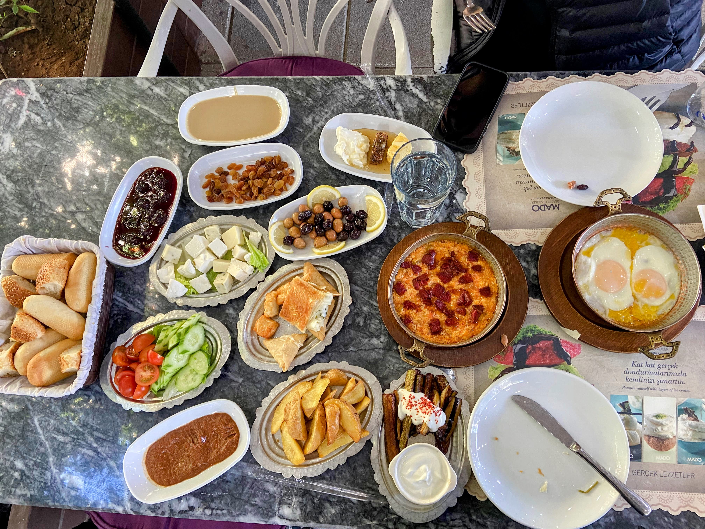{: width="4032" height="3024" decoding="async" loading="lazy" srcset="/assets/img/article_imgs/turkey-roadtrip/reading/45-breakfast-480.webp 480w, /assets/img/article_imgs/turkey-roadtrip/reading/45-breakfast-800.webp 800w, /assets/img/article_imgs/turkey-roadtrip/reading/45-breakfast-1300.webp 1300w" sizes="(max-width: 698px) calc(100vw - 48px), 650px"}

After breakfast we head out to see the Seyhan Dam Lake. A recreational area in Adana with plenty of restaurants and activities to do around.

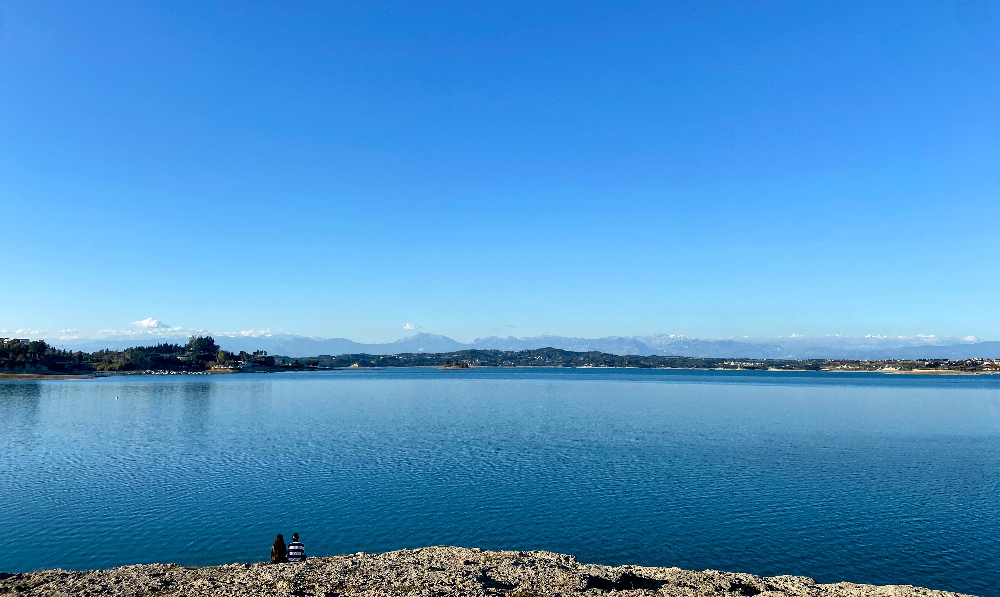{: width="4032" height="2408" decoding="async" loading="lazy" srcset="/assets/img/article_imgs/turkey-roadtrip/reading/46-seyhan-480.webp 480w, /assets/img/article_imgs/turkey-roadtrip/reading/46-seyhan-800.webp 800w, /assets/img/article_imgs/turkey-roadtrip/reading/46-seyhan-1300.webp 1299w" sizes="(max-width: 698px) calc(100vw - 48px), 650px"}

We enjoy some sahlep by the lake. A hot, floral, milky dessert topped with cinnamon and nuts. Perfect in the winter.

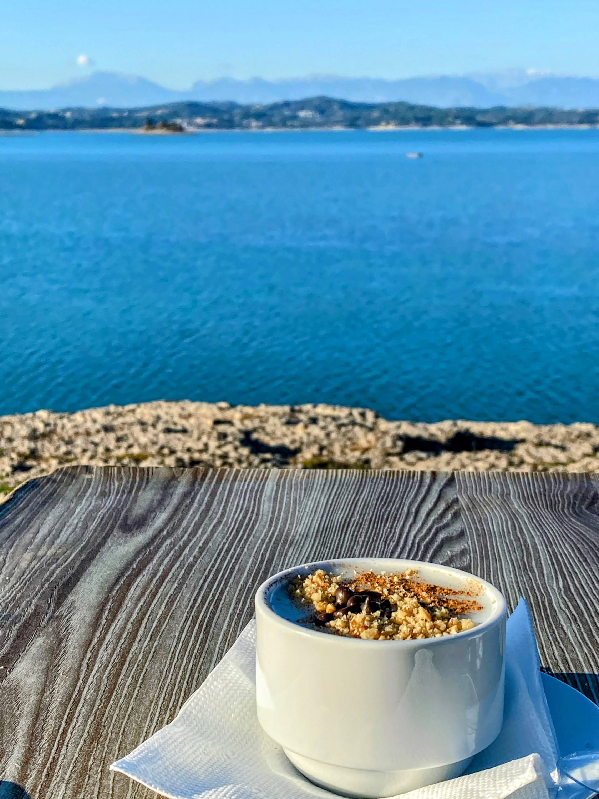{: width="2877" height="3836" decoding="async" loading="lazy" srcset="/assets/img/article_imgs/turkey-roadtrip/reading/47-sahlep-480.webp 480w, /assets/img/article_imgs/turkey-roadtrip/reading/47-sahlep-800.webp 800w, /assets/img/article_imgs/turkey-roadtrip/reading/47-sahlep-1300.webp 1300w" sizes="(max-width: 698px) calc(100vw - 48px), 650px"}

We head out back towards Mersin and the Mediterranean in the afternoon, wrapping up our coastal trip.

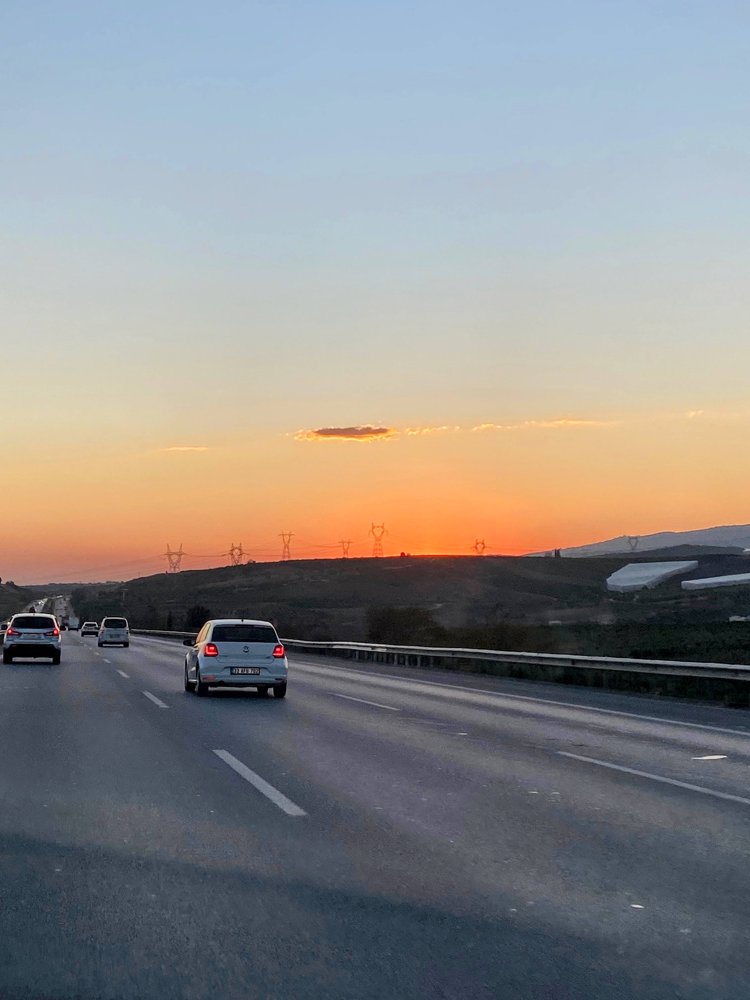{: width="3024" height="4032" decoding="async" loading="lazy" srcset="/assets/img/article_imgs/turkey-roadtrip/reading/48-road-480.webp 480w, /assets/img/article_imgs/turkey-roadtrip/reading/48-road-800.webp 800w, /assets/img/article_imgs/turkey-roadtrip/reading/48-road-1300.webp 1300w" sizes="(max-width: 698px) calc(100vw - 48px), 650px"}

and Mersin the next morning.

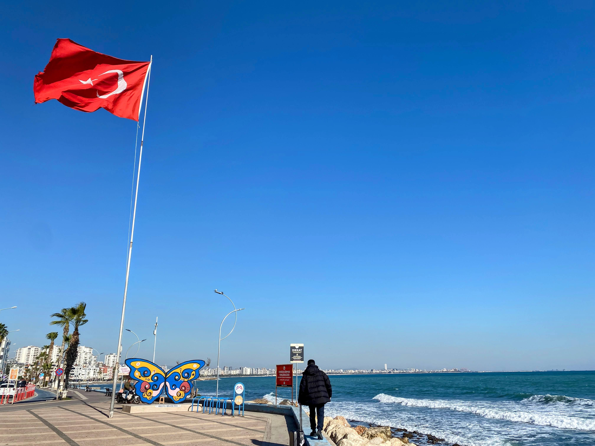{: width="4032" height="3024" decoding="async" loading="lazy" srcset="/assets/img/article_imgs/turkey-roadtrip/reading/49-mersin-480.webp 480w, /assets/img/article_imgs/turkey-roadtrip/reading/49-mersin-800.webp 800w, /assets/img/article_imgs/turkey-roadtrip/reading/49-mersin-1300.webp 1300w" sizes="(max-width: 698px) calc(100vw - 48px), 650px"}

And that wraps up our Anatolian adventure. 

From fairy chimneys to underground cities, we've uncovered a unique piece of Turkey's soul. 

Thank you for joining me on this adventure, keep wandering and making memories! 🚗🌄