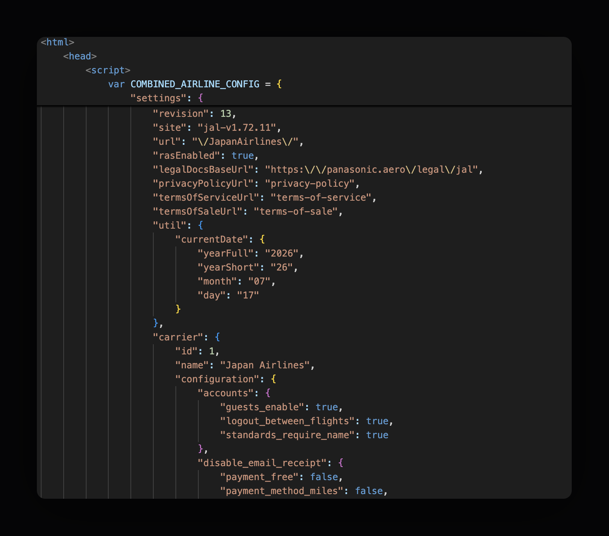
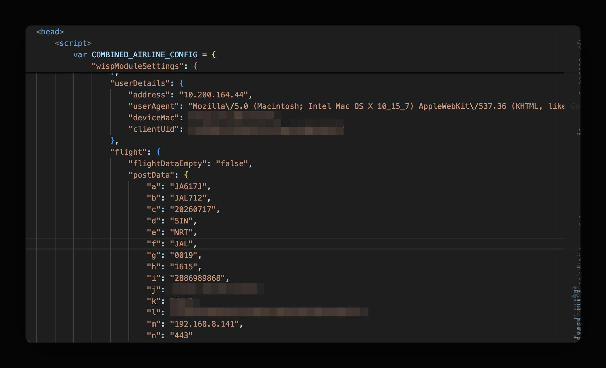
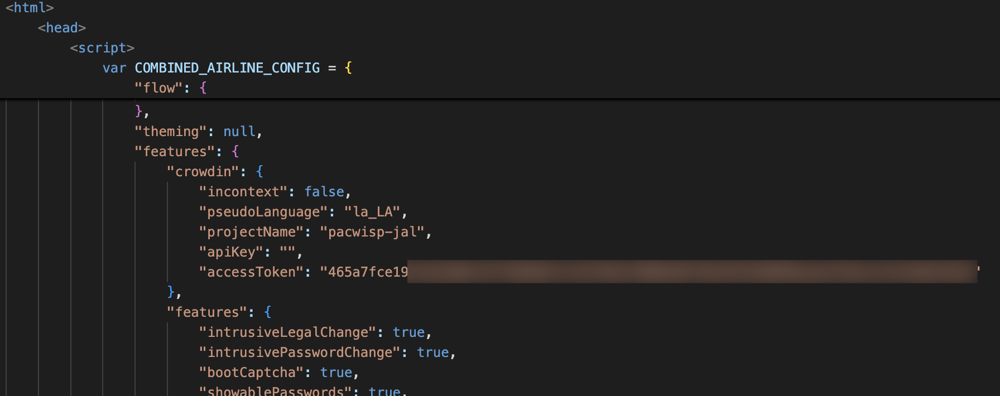
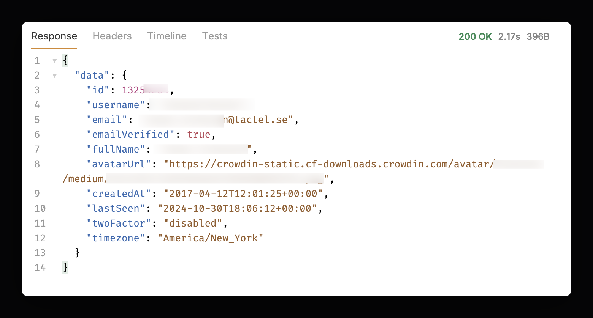
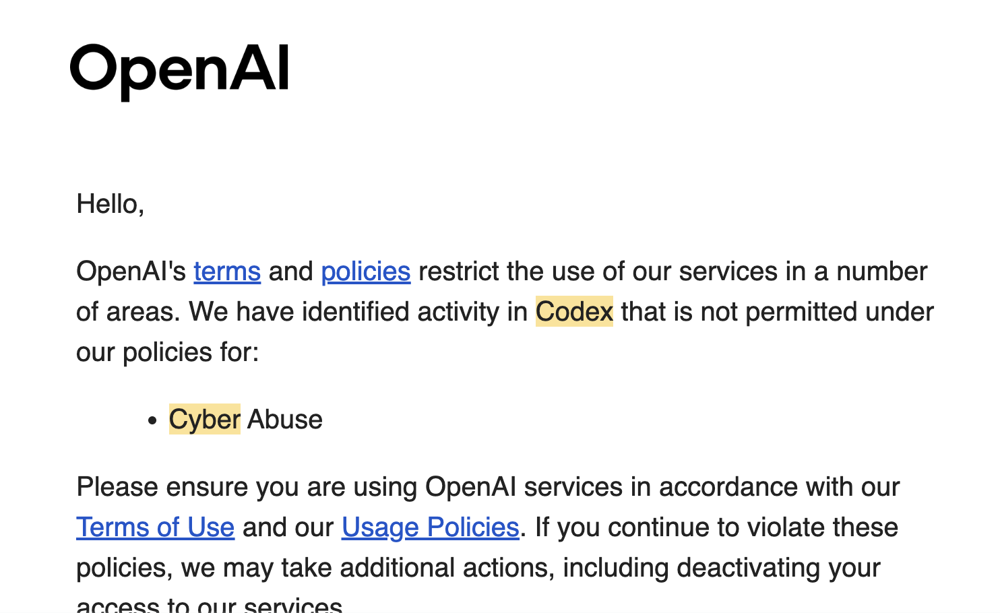
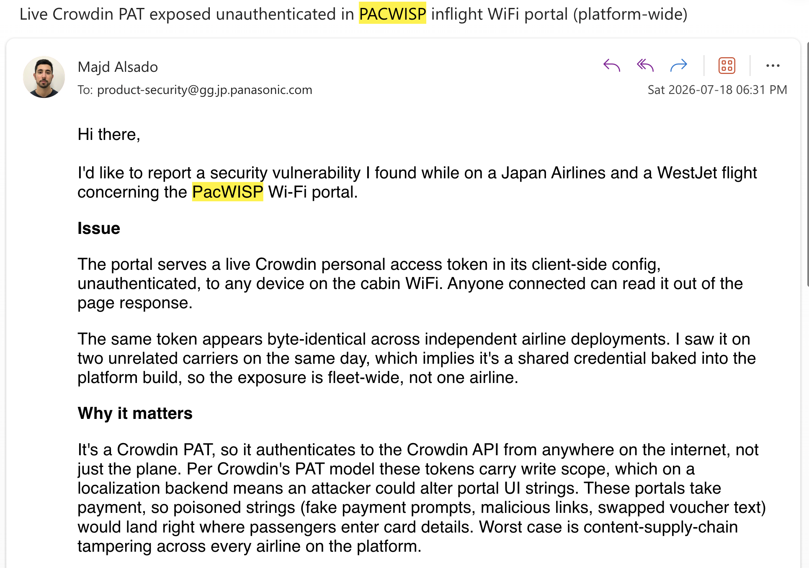

_no ai was used in writing this content._

# airplane wi-fi portals
I was recently on a plane to singapore, trying to get some Wi-Fi.

Being the nosy person that I am, I opened DevTools and started poking around the portal to understand how it worked.

I've always found these portals clever because they have to provide the user with *just* enough internet connection to purchase a plan, but nothing more. 

That is difficult. So I like seeing how providers design around it.

# pacwisp

The first thing I noticed was that the portal was a white-labeled service called "PacWisp", from Panasonic.

Interestingly, much of the portal's configuration was exposed client-side, in a JSON blob embedded in the page's HTML.

<figure class="article-figure">
  
  <figcaption>PacWisp airline configuration embedded in the portal HTML.</figcaption>
</figure>

It contained basic things like the airline's name, logo, and available plans.

<figure class="article-figure">
  
  <figcaption>Flight and device details in the client-side configuration. Identifiers are obscured.</figcaption>
</figure>

But it also contained more specific parts, like my flight data, and device information.

None of this was particularly alarming, but it did leak lots of information about the app. 

I assumed they _likely_ had some sort of server-side validation to ensure clients can't modify this data in an unauthorized manner.

# crowdin and localization

Then something caught my eye.

Buried in the configuration was a key named `crowdin.accessToken` with a hash-like value.

<figure class="article-figure">
  
  <figcaption>The Crowdin accessToken field in the portal configuration. The token is obscured.</figcaption>
</figure>

Coincidentally, I had just finished setting up localization/i18n for [Bidaya](https://bidaya.ai/fr) and had heard about Crowdin as a localization SaaS.

It made sense for PacWisp to use a service like this. Airlines work across many languages and countries, so using a platform for maintaining these interfaces is normal.

What didn't make sense is why an access token would be needed here.

This was an unauthenticated portal, albeit gated to the flight, but nonetheless an untrusted semi-public network. You shouldn't need access token to access localization strings.

**Was this a harmless read-only token, or something else?**

# a live personal access token in plain sight

At this point I decided to pay for the internet.

Naturally, my first stop was the Crowdin API docs. What was this token? 

I found a /me endpoint, setup the request in Bruno, and added the token in. And well:

<figure class="article-figure">
  
  <figcaption>The Crowdin /me response returned account details. Personal information is obscured.</figcaption>
</figure>

Yikes. 

A live personal access token issued in 2017 *(9 years ago)* attached to an employee of a Swedish IT firm. Last accessed in 2024 *(2 years ago)*.

That can't be good.

So **what can this token actually access?**

# codex freaks out

To answer this question, I lazily turned to my handy friend Codex. 

Going through the API docs to find suitable endpoints to test did not sound like an interesting task I'd want to continue doing in Bruno.

So Codex got to work, and as things were unravelling, it stopped.

Cybersecurity guardrails kicked in.

Shortly after, I received a scary email.

<figure class="article-figure">
  
  <figcaption>The OpenAI email flagging my Codex activity for cyber abuse.</figcaption>
</figure>

Flagged for cyber abuse...

# chinese models

At this point I still wasn't sure what this token could do.

**Is this a read-only token? could it modify translations? how many portals were affected? do I need to report this?**

It was clear my subscriptions to Claude and Codex were not going to help, and I didn't want to risk a ban. 

So I had to look elsewhere.

I knew chinese models were quite capable, and had almost no guardrails, so I downloaded opencode, connected to my openrouter account, and selected kimi k3.

Within 30 seconds, kimi confirmed my suspicions. **the token had full admin read/write access to 25+ airlines' localization projects on Crowdin/PacWisp.**

# flight #2

Coincidentally, on my next flight, I found myself on another airline with the exact same PacWisp portal, and the same api key.

So this seemed pretty bad, the same credential appeared across multiple deployments on multiple airlines.

I drafted a report and sent it over to Panasonic Aviations that same day.

<figure class="article-figure">
  
  <figcaption>My vulnerability report to Panasonic’s product security team.</figcaption>
</figure>

_Update: As of writing, Panasonic has confirmed that this vulnerability has been patched._

# codex thinks i violated their tos

This was a pretty bad vulnerability. Anyone with access to this token for the past 9 years was able to edit content wi-fi portals across 25+ airlines worldwide.

I tried to use AI to help confirm and report this vulnerability. but codex flagged me for cyber abuse and threatened to ban me.

# whats the difference between a defender and an attacker?

To be fair to AI companies, this is a hard problem. On a surface level, these companies carry some responsibility for what their models are used for.

But malicious requests are difficult to discern from harmless ones. the actual work of a black-hat hacker, and a white-hat hacker looks almost identical. it's primarily the motivation and objective that's different.

So in lieu of knowing motivation, they found it easiest to just ban it all, and anything close to it.

# "just throw it to kimi"

At this point, a common sentiment for anyone serious about cybersecurity is to use a chinese model to do their work.

Importantly however, while **malicious developers are already doing this**; only a small subset of well-intention developers are.

So **this block effectively only stops good people from protecting themselves**, or helping report issues like I was trying to above.

# we must have the right to protect ourselves

I guess this wouldn't be a problem if we had alignment across all AI labs worldwide, and security capabilities were truly restricted to only verified companies which we all depend on, to protect themselves.

But this is not the case.

Thus, we must design for a world where everyone can perform cybersecurity tasks with LLMs.