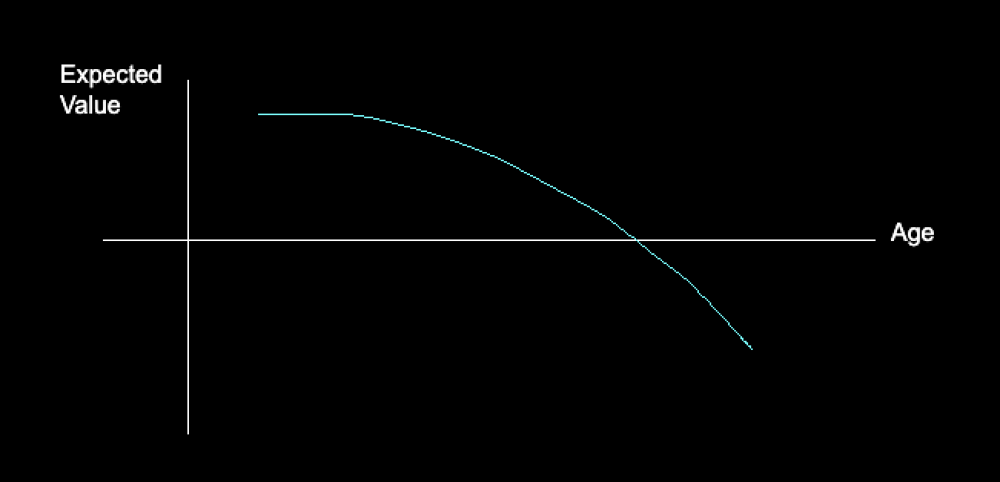

# people don't like change

As humans, we like to do the same things, in the same way, on all levels.

People are uncomfortable in new spaces, and in new interactions. 

We tend to get some level of anxiety, or stress, from new different things.

People's first reaction to change is usually negative. It's such a common reaction that we have a term for it, **change aversion**.

Even biologically, our body doesn't like change, as it's constantly trying to achieve homeostasis.

People crave routines, we try to build habits, and we tend to feel better when we have them.  Waking up and sleeping at the same time is proven to improve function. 

But most importantly, we don't like to change. It's painful to change.

# in the wild

As a founder, I learned this lesson the hard way. 

I found that often, when I redesigned an interface, users tended to have a negative initial reaction. 

It didn't matter what the change did, or if it was an improvement.

People have change aversion to UI changes. [See the Intercom team's write-up on their experience dealing with change aversion.](https://www.intercom.com/blog/navigating-the-complexity-of-change-aversion)

Think about the last time you saw a tool you frequently use change its UI. I'd bet you likely didn't react positively the first time you saw the change.

Familiar app users will almost always have a negative reaction to change, even if it's for the better.

# we're somehow the best at change

Though all of the above is true, we're interestingly also the most adaptable creatures.

We're somehow the best at change.

Anthropologically, humans have been able to survive in radically diverse environments and changing circumstances throughout history.

**So why is it, that we feel change as painful?**

# but why do we feel pain?

The objective of instincts and feelings is to:

1. **encourage** behaviors which **improve** our ability to **survive** and reproduce
2. **discourage** behaviors which **harm** our ability to **survive** and reproduce.

In other words, feelings serve as an optimizing function of expected value (EV) for our survival.

This is intuitive, even though our feelings in modern times can misfire. At a basic level, eating, sleeping, drinking water, seeing friends and family all feel good. 

**We're programmed to feel good about things which promote survival.**

# so what does that mean for change

We've established change feels bad.

We've also established that something that feels bad, likely has negative EV for survival.

**Hence, it appears that change has negative EV for survival.**

# change should feel bad

The negative survival EV makes sense. 

For the UI example I initially mentioned above, it slowly started to become clear to me that people not liking a UI change is actually very rational.

It's not that people don't understand that there was some improvement made when something familiar changes. 

It's that for someone familiar with something, most change gives a negative EV. 

In the UI change example above, a user must re-learn a new interface, which distracts them from work. (An exception is **new** users who can now pick-up the interface quicker).

> **If you've been doing something a certain way, change likely means you're accepting some sort of loss. A sunk cost.**

This also explains why kids seem to deal with change better than adults. They have yet to develop ways to work.

This corrborates with my personal experience as well. As a kid, I loved new technology. My favourite activity was trying a new app, a new interface, or finding a new way of doing the same thing.

As I got older though, I felt that craving for novelty start to fade. The bar for me to try something new got higher. I learned what worked for me, and what wouldn't.

The equation changed, it feels as if expected value of trying something new went down.

**Our mind protects its perceived ability to survive. Aversion to change is a mechanism which achieves that.**

# but modern change is different
the key problem with our conclusion above though, is that our mind is optimizing for survival, in a world where survival is trivial.

The UI change does not affect our survival ability, it actually might improve it. As a matter of fact, it probably *does* improve it. 

Our mind's biological aversion to change, developed over 1000s of years of survival optimization, now serves to hinder our ability to adapt in the modern world.

We miss out on opportunities, or experience great displeasure at something that's could help us thrive.

In the modern day, change aversion by default feels like a flaw. Our instincts misfiring.
 

# we need to reprogram our change aversion to do our best work

Creative expression is very difficult if you have change aversion.

Being creative requires change. It demands you to view and embrace new ideas and way of working.

Hence, I need to push myself to suppress these feelings to build something worthwhile.