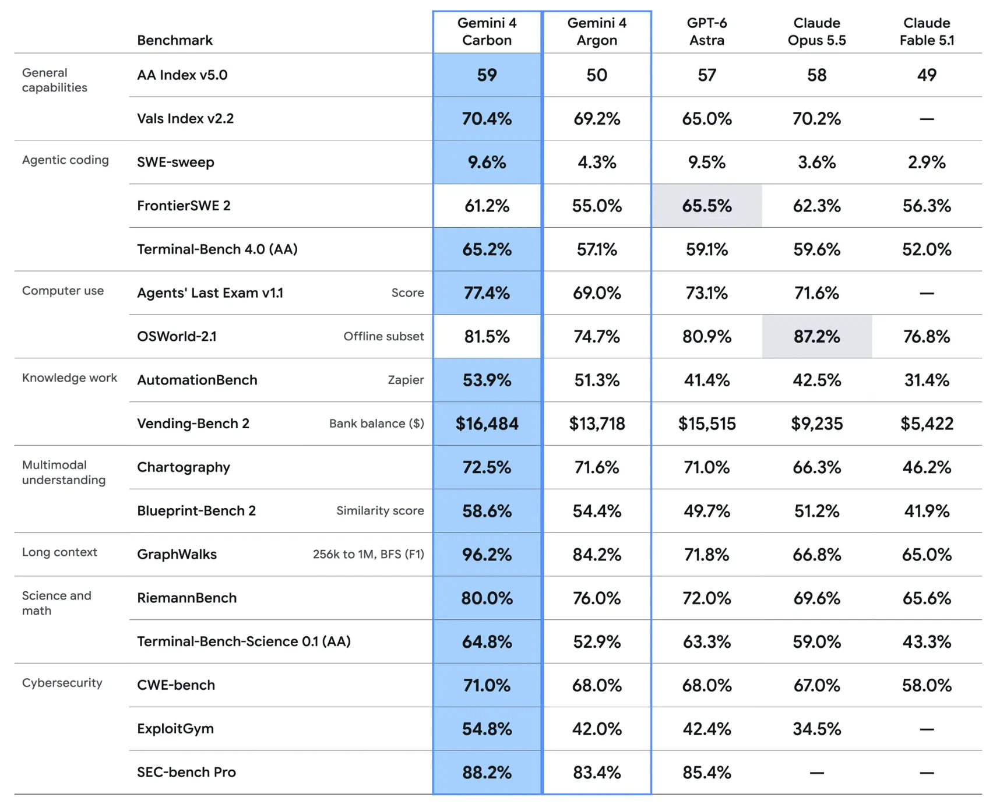
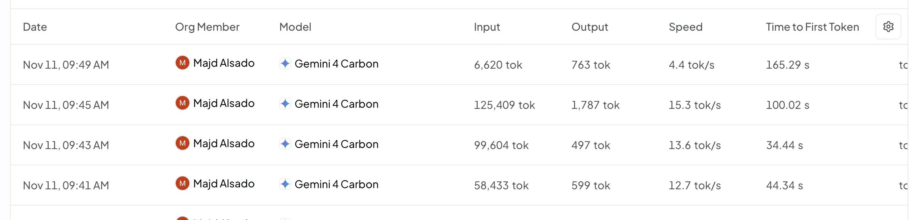
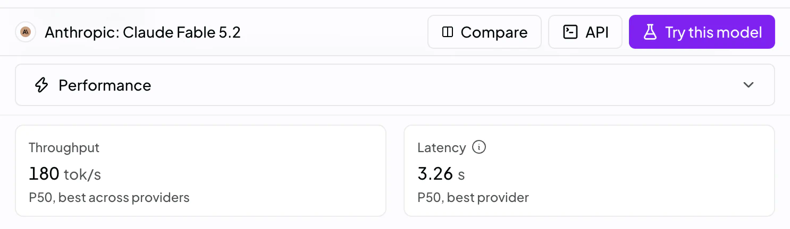

Two weeks after announcing Gemini Carbon, Google has finally made it available to users.

Their benchmarks were, as always, impressive:

{: width="1716" height="1380" fetchpriority="high" decoding="async" }

A model which outperforms Claude Fable 5.1 on every benchmark? I need to try this...

Yes, waiting two weeks after announcement to release a model in this industry is long, unheard of even. BUT, on the bright side, it's probably a polished model now, ready to be served, _**right??**_

{: width="2390" height="580" loading="lazy" decoding="async" }

The above is an OpenRouter request log from one of my sessions, where I was trying to use Carbon for some light coding tasks and evals.

It shows the Carbon's performance across turns, notably with a:
- Time to First Token (TTFT) of 165s
- Throughput < 20 tok/s

That's insane. Unusable. **Embarrassing even.** I've never seen any model perform like this.

Mind you I'm using OpenRouter, which routes to the best provider at that time.

This degraded performance is unfortunately not a one-off. Across my testing in the past two days, I've experienced poor performance for this model during most of my testing. (One notable exception was a session I had at 12am mountain time last night where I got  _average_ performance, ~30 tok/s, 10s TTFT)

Compare that with Fable 5.2, a model released by a company which:
- has order of magnitude less experience in infrastructure than Google
- has been in business for 5 years (compare to Google's 28)
- **ISN'T A TOP 3 CLOUD PROVIDER**

{: width="1486" height="432" loading="lazy" decoding="async" }

p50 mind you...

Never mind all the usual Gemini bugs, which somehow still haven't gone away [see gemini article](https://alsado.ca/posts/gemini/). In 2026, I still don't see a path where I could adopt Gemini models for anything requiring reliable intelligence.

Looks like Bidaya's Vertex AI credits are gonna go unused, too bad.
